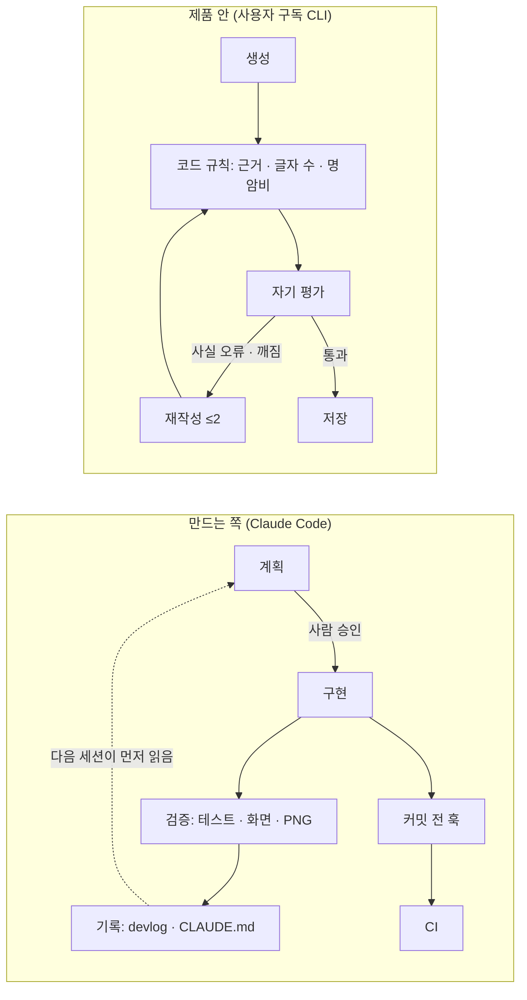

# 중간 보고서 초안 (PDF 5쪽 이내)

> 2026-10-21 작성. **주 제출물은 이 보고서**다(2026-10-21 받은 공지 — 모든 참가자, PDF 5쪽 이내, 서면 평가 가능). 순서는 공지 양식 그대로.
> 숫자는 모두 레포 파일에서 옮겼고 괄호에 출처를 적었다. **PDF 로 옮길 때 출처 괄호는 줄이거나 각주로** 바꾼다.
> **학번 · 이름 등 개인정보는 이 파일에 넣지 않는다** — PDF 는 레포 밖에서 만들고 그때 표지에 넣는다 **(사용자)**.
> 쪽 배분(사용자 지시): ① 기획안 2쪽 · ② AI 워크플로우 및 환경 설정 1.5쪽 · ③ 초기 프롬프트 전략 1쪽 · ④ 향후 계획 0.5쪽. 분량 추정은 맨 아래 「분량 추정」.

---

## ① 프로젝트 기획안 (2쪽 — 독창성 30 · 문제 정의 및 기획 20)

### 시작 이야기

AI 로 만든 것들을 정리하려고 인스타 계정을 시작해 한 달 만에 팔로워 1,500명을 모았고, 대외활동 선정과 협찬 제안으로 이어졌다(PRD v0.1 1-1). 운영하며 얻은 결론은, 누구나 비슷한 결과물을 만드는 시대에는 「나는 누구인가」를 분명히 하는 것이 가장 중요한데 처음 시작하는 사람에게 그게 가장 어렵다는 것이다.

### 문제 정의

인스타 입문자는 (P1) 계정 정체성이 넓어 소재가 금방 떨어지고, (P2) 게시물마다 디자인이 달라 한 계정처럼 보이지 않고, (P3) 매일 소재를 고르기 어렵고, (P4) 숫자를 보고도 다음에 뭘 바꿀지 모르고, (P5) 성장하면 대외활동·협찬 마감이 흩어진다(PRD v0.2 1장). 이번 버전은 **P1·P2·P4 를 잇는 카드뉴스 기본 흐름**을 먼저 완성한다.

### 해결 방안 — 퍼스트피드

자기 컴퓨터에서 도는 로컬 앱(웹 화면 + 로컬 서버)이다. 설문과 AI 인터뷰로 **브랜드 프로필**을 만들고, 그 프로필 하나로 이름·바이오·팔레트·폰트 → 고정 템플릿 → 카드뉴스 → 업로드 폴더까지 이어 간다. AI 는 사용자 본인의 Claude 구독(Claude Code CLI)으로 돈다. 대상은 Claude 를 구독하고 인스타를 처음 시작하는 사람이다(PRD v0.2 3장).

### 차별점 4가지 (그림 1~3 — 근거는 [독창성.md](독창성.md))

1. **근거 없는 숫자·이름은 코드가 잡아 다시 쓰게 한다.** 숫자·날짜·영문 이름이 소재 원문·프로필·구조상 숫자·사용자 글 어디에도 없으면 재작성하고, 끝내 못 고치면 저장하지 않는다. 확인할 수 없는 용어 풀이는 표시해 사람이 확인해야 내보낼 수 있다 → **그림 1**
2. **답변 → 정체성 → 브랜딩 → 템플릿 → 카드뉴스가 한 프로필로 이어진다.** 같은 템플릿이 브랜드마다 다른 색·폰트로 그려진다 → **그림 2**
3. **프로필을 바꾸면 이후 생성이 바뀐다.** 말투를 반말로, 축 하나를 「실패 기록」으로 바꾸자 바이오가 「정리해요」→「정리해」, 「대외활동 기록」→「실패 기록」으로 바뀌었다(실제·공개 1회) → **그림 3**
4. **정체성의 축마다 사용자가 한 말이 인용으로 붙는다.** 원문에 실제로 있는지 코드가 확인한 인용만 저장한다(측정의 무효 인용 0)

### 기본 흐름의 핵심 기능 (전체 63개는 [PRD v0.2 4장](../PRD.md))

| FR | 기능 | 수용 기준 (한 줄) |
|---|---|---|
| FR-ID-2 | AI 인터뷰 | 한 번에 한 질문씩 3~10개, 근거가 부족한 축이 있으면 한도 안에서 더 묻는다 |
| FR-ID-4 | 브랜드 프로필 초안 | 축 3~5개마다 원문 인용, 인용이 원문에 없으면 버리고 근거 축이 3개 미만이면 인터뷰로 돌아간다 |
| FR-ID-6 | 프로필이 이후 생성의 입력 | 활성 판을 바꾸면 바로 다음 생성의 축·말투·피할 것에 반영된다 |
| FR-TP-3 | 템플릿 고정 | 고정한 시안 판으로만 카드를 만들고, 바꾸면 새 판을 남긴다 |
| FR-MK-1 | 카드뉴스 | 표지 제목 6개에서 골라 본문 N장·마무리, 한 장에 한 가지 말과 원문 인용 하나 |
| FR-MK-2 | 근거 대조 | 숫자·버전·날짜·영문 이름을 허용 출처 4가지와 대조해 없으면 재작성, 소재 밖 풀이는 확인 전 내보내지 않는다 |
| FR-PB-1 | 업로드 준비 | 올릴 그림만 번호순 폴더에, 캡션 파일은 바깥에, 캐러셀 20장을 넘으면 만들지 않는다 |

범위는 우선순위 M(중간까지) · F(최종까지) · S(여유) · W(이번 버전 안 함)로 나눴다. M 20개 중 끝난 수는 `docs/process/status.md` 집계를 옮긴다(PDF 를 만드는 날 다시 본다).

---

## ② AI 워크플로우 및 환경 설정 (1.5쪽 — AI 활용 계획 40)

### 도구 선정 (근거: [AI-활용-계획.md](AI-활용-계획.md) 0-1)

- **기획**: Claude 대화로 PRD v0.1 을 쓰고, 개발 중 쌓인 결정을 넣어 매니패스트로 PRD v0.2 · 기능명세서 · 유저플로우를 다시 만들었다
- **구현·검증·기록**: Claude Code(Claude Opus 5.5). 제품이 부르는 것과 같은 CLI 라서, 개발하면서 구독 로그인·실행 폴더 설정이 섞이는 문제 등을 직접 재고 막았다
- **제품 안의 AI**: 사용자 구독의 Claude Code CLI. 운영자가 API 요금을 대지 않는 대신, 유료 구독·터미널·느린 호출(프로필 평균 63초)이라는 한계가 있다
- (사용자가 채움: Cursor · Copilot 등 대신 이 도구를 고른 개인적 이유 1~2줄 — 레포에 기록이 없다)

### 개발 파이프라인 (그림 4)

세션마다 **계획(사람 승인) → 구현(AI) → 검증(테스트·화면·PNG 직접 확인) → 기록(devlog)**. 규칙 문서 CLAUDE.md 를 AI 가 세션마다 먼저 읽고, 결정은 날짜·이유와 함께, 오류는 「원인의 모양」으로 쌓는다. 외부 사실(인스타 앱 동작·격자 가림)과 제품 방향은 사람이 정했다(결정 기록 11건 — AI-활용-계획.md 1장). 커밋 전 훅이 개인정보·린트·타입·테스트를 막고, 푸시 뒤 CI 가 다시 본다.

### 제품 안의 AI 구조

모든 호출은 **어댑터 한 곳** → 생성 → **코드 규칙 검사** → 자기 평가(다른 프롬프트) → 재작성(최대 2회) → 통과한 것만 저장. 재작성 사유는 코드 규칙 위반과 자기 평가의 「사실 오류」·「깨짐」뿐이고 말투 지적은 경고만 한다(CLI 한 번이 수십 초라 비용이 커서). CLI 는 안전 모드 + 빈 임시 폴더 + 도구 끔으로 실행해 파일 쓰기·명령 실행을 열지 않는다.

### 환경 설정

Node 24 · TypeScript 6.0.3 · React 19 + Vite 8 · Hono · SQLite(`node:sqlite`) · Playwright Chromium(카드 렌더링 기준 브라우저) · 커밋 전 훅(`.githooks/pre-commit`) · GitHub Actions CI · 프롬프트 파일 `prompts/<이름>/vN.md` · 평가 스크립트 8개 · 대화 기록 내보내기(`npm run export:transcripts`, 키·이메일 등 가림)

---

## ③ 초기 프롬프트 전략 (1쪽)

- **프롬프트는 코드 밖 파일로, 고치지 않고 새 판을 만든다** — 같은 테스트 세트로 전/후를 나란히 잰다. 지금 17종 28판
- **테스트 세트는 실제 자료 우선**, 부족한 부분만 AI 생성. 결과도 실제·공개 / 실제·비공개 / AI 생성으로 나눈다(AI 가 만든 세트로 AI 를 평가하면 순환이라서)
- **전후 숫자** (각 숫자의 파일·커밋은 AI-활용-계획.md 3장)

| 바꾼 프롬프트 | 전 → 후 | 단서 |
|---|---|---|
| 정체성 프로필 v1 → v2 | 1회 통과 2/8 → 6/8, 평균 재작성 0.88 → 0.25 | 짧은 인용 문제는 프롬프트가 아니라 코드 수정으로 풀렸다 |
| 꼬리질문 v1 → v2 | 앞 답을 인용하며 묻기 1/10 → 8/10(AI 생성) | 질문이 3~5초 느려짐 |
| 바이오 자기 평가 v1 → v2 | 최종 바이오에 남은 「하지 않은 약속」 2 → 0 | 사람이 셈 |
| 카드·캡션 자기 평가 v3·v1 → v4·v2 | 지어낸 감상 놓침 2/2 → 잡음 2/2, 과잉 판정 0/8 | 고정 입력 × 2회 |
| 자기 평가 v1 → v2 | 1회 통과가 오히려 줄었다 | 잡은 4건이 모두 실제 축 겹침이라 채택 |

- **측정을 믿기 전에 확인한다**: 새 판으로 잰 줄 알았던 카드 측정이 셸 인자 문제로 옛 판으로 돈 것을 결과 머리 줄에서 찾아 정정했다(다시 재니 실제 소재는 6/0 → 5/1). 표본이 작다(사람당 1~2회)는 것도 숨기지 않는다

---

## ④ 향후 계획 (0.5쪽)

- **11-01 까지**: 설치 점검 명령(FR-AC-6), 남은 M 확인(설문 2분 측정 · FirstFeed 카드로 업로드 순서 · 하이라이트 커버)
- **중간 발표 뒤 ~ 11-15**: 캡션 완성(FR-MK-7) · 말로 고치기(FR-MK-3) · 지인 2명 실사용 시작
- **11-16 ~ 11-29**: 성과 입력 → 다음 행동 제안 → 프로필 갱신(FR-IN-2~6)
- **범위 축소 조건**: 11-15 까지 실사용자 2명이 시작 못 하면 성과·대외활동을 하나로, 11-29 까지 성과가 안 끝나면 대외활동은 W
- Codex · Gemini · API 키 · AI 미연결 가이드는 여유가 있으면(S) — 어댑터가 한 곳이라 공급자만 더하면 된다

---

## 그림 목록 (서면 평가 대비 — 차별점은 그림으로)

| 그림 | 무엇 | 레포에 이미 있는 것 | 사용자가 캡처·제작해야 할 것 |
|---|---|---|---|
| 1 | 근거 없는 숫자를 잡아 다시 쓴 전후 | 규칙이 뺀 표지 후보와 이유(글): 「평일 0분 주말 40분」 → `소재·프로필·메모에 없는 숫자 "0"`(`tests/results/2026-10-15-cards-body-v1.md` 151줄, AI 생성 소재) · 그 회차의 최종 카드 PNG `tests/results/2026-10-15-cards-body-v1/dessert-visit-seoyeon-*/01-cover.png` | **재작성 「전」 문장이 남은 기록이 없다.** 앱 만들기 화면의 「규칙에 걸려 뺀 후보 N개」를 펼친 화면(이유가 보이게) + 고른 표지 카드. 리허설에서도 「제목 후보 6개 중 1개가 규칙으로 제외」가 나왔다(devlog 2026-10-21-02) |
| 2 | 빈 화면 → 격자 9칸 | 실제 소재로 만든 표지 PNG 11장(`tests/results/2026-10-2[01]-cards-real-v3/*/01-cover.png`, 운영자 본인 = 실제·공개) · 같은 시안 × 브랜드 3개 한눈에 보기(`tests/results/2026-10-15-templates/<시안>-<브랜드>/_sheet.png`) | **앱에 격자 미리보기가 없다**(FR-BR-5, S · 안 함). 「빈 화면」은 새 계정 프로필 캡처, 「격자 9칸」은 실제 게시 뒤 프로필 캡처 또는 PNG 9장을 레포 밖에서 3×3 으로 붙인 그림 — 붙인 그림이면 「합성」이라고 적는다 |
| 3 | 말투 바꾸기 전후 | 전후 바이오 글: `tests/results/2026-10-14-brand-reflect-me.md`(실제·공개, 각 1회) | 브랜드 화면의 바이오 후보를 바꾸기 전·후로 캡처하거나, 위 파일의 바이오 두 줄을 나란히 놓은 그림 |
| 4 | AI 워크플로우 | 없음 — 아래 초안(mermaid) | 아래 초안을 그림으로 옮긴다 |

그림 4 초안:

- 미리 만든 결과로 찍은 캡처는 「미리 만든 결과」 표시가 보이게 한다(결정 2026-10-18)
- 그림 속에 다른 사람의 이름·얼굴·연락처가 없는지 본다 — 개인정보 검사는 이미지를 읽지 못한다 **(사용자)**

---

## 분량 추정

> **쪽당 글자 수는 가정값이다** — 공지의 「중간 발표 양식」 파일을 레포에서 확인하지 못했다. 양식을 받으면 그 틀에서 다시 잰다. 가정: 본문만 있는 A4 한 쪽 ≈ 1,500자, 그림 하나 ≈ 반 쪽.

| 부분 | 목표 | 본문 글자 수 (출처 괄호 뺀 값) | 그림 | 추정 쪽 | 판정 · 줄일 후보 |
|---|---:|---:|---|---:|---|
| ① 기획안 | 2 | 1,753 (1,684) | 1 · 2 · 3 | 1.2 + 그림 1.5 = **약 2.7** | **넘침(약 0.7쪽)** — 줄일 후보: ⓐ 그림 3 을 그림 대신 바이오 두 줄 인용으로(−0.5쪽) ⓑ 핵심 기능 표 7줄 → 5줄(FR-TP-3 · FR-PB-1 은 흐름 문장에 이미 있음, 약 −150자) ⓒ 시작 이야기를 두 문장으로 ⓓ 그림 1·2 를 반 쪽에 나란히 |
| ② AI 워크플로우 및 환경 설정 | 1.5 | 1,152 (1,103) | 4 | 0.8 + 0.5 = **약 1.3** | 들어감. 「사용자가 채움」 도구 선정 이유 1~2줄 자리 남김 |
| ③ 초기 프롬프트 전략 | 1 | 694 (658) | — | **약 0.5** | 들어감. 표가 글자 수보다 자리를 더 차지한다 — PDF 에서 확인 |
| ④ 향후 계획 | 0.5 | 357 | — | **약 0.2** | 들어감 |
| 합계 | 5 | 3,956 | 4개 | **약 4.7** | 5쪽 안이지만 ① 이 목표보다 길다. 표지(이름·학번)를 본문 쪽에 넣으면 ⓐ 부터 줄인다 |

- 세는 법: 각 부분 제목 아래부터 다음 부분 제목 전까지, 마크다운 기호(`` ` * | # > ``)와 표 구분 줄을 빼고 공백·줄바꿈 포함으로 셌다(2026-10-21, devlog 2026-10-22-01). 쪽 수 = 글자 수 ÷ 1,500(가정) + 그림 수 × 0.5(가정)
