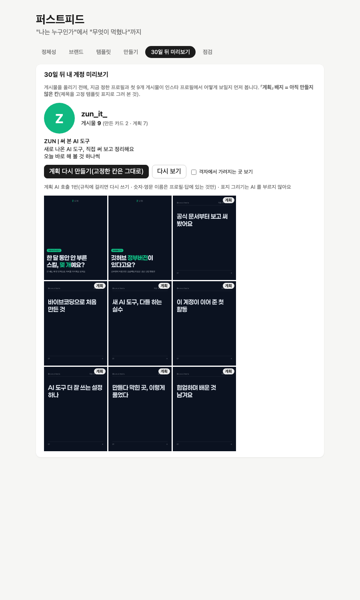
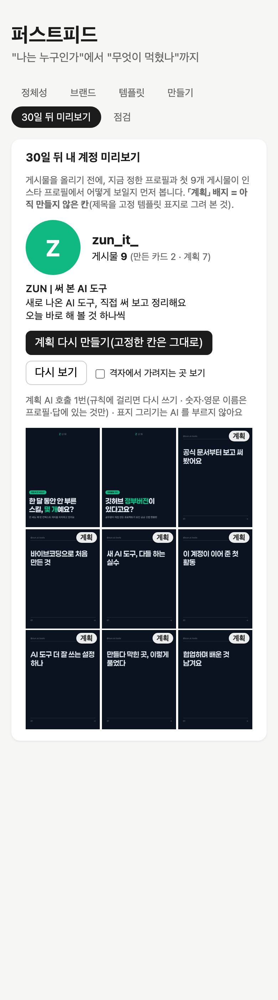
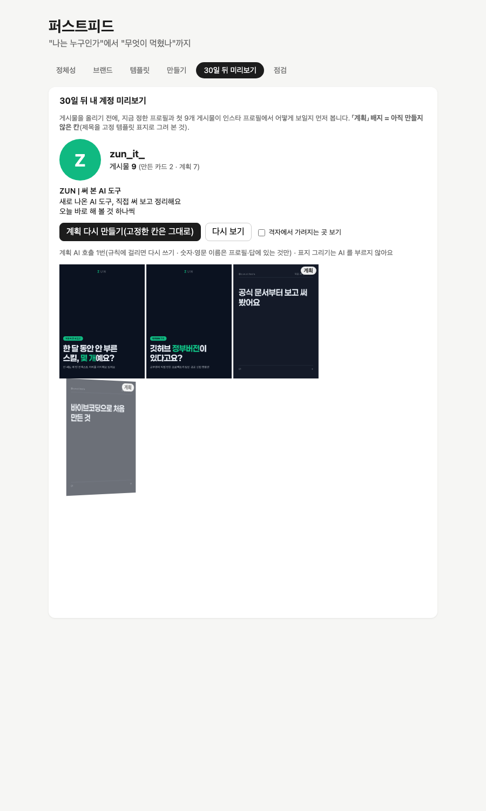

# 2026-10-22-02 · 미리보기를 완성된 계정처럼 — 계획 칸 표지 · 채워지는 모션 · 시리즈 계획 v2

| 항목 | 내용 |
|---|---|
| 세션 ID | `6887510c-f5b2-49b7-a2cf-d074e050fe51` (같은 세션) |
| 시간 | 2026-10-22 새벽 KST |
| 도구 · 모델 | Claude Code · Opus 5.5 |
| 목표 | 「30일 뒤 미리보기」를 보자마자 완성된 계정처럼 보이게(정직성 규칙 유지) · 시리즈 계획 v2 |
| 관련 요구사항 | FR-BR-6 |
| 커밋 | `3732575` 서버 · `2ecdb13` 화면 · `ca6e831` 프롬프트 v2 · 이 devlog(+ 보고서 그림 2) |

## 한 일

### 1. 계획 칸을 실제 표지로 (`3732575`)
- `server/src/preview/covers.ts`: 계획 칸 제목을 카드 표지와 같은 `renderFrame`(같은 넘침 규칙)으로 그린다 — **AI 호출 없음**. 표지 내용은 {제목, 칩 = 축 이름}
- 넘치면 PNG 를 만들지 않고 이유를 돌려준다 → 화면은 그 칸만 지금의 자리표시 + 「표지로 못 그림: 이유」
- 캐시: [제목 · 축 이름 · 고정 템플릿 판] 해시가 같으면 다시 쓴다(실패도 이유와 함께 캐시). 칸 하나를 고치면 그 칸만 다시 그려진다. 브라우저 하나를 돌려 쓰려고 한 번에 하나씩
- API: `GET /api/preview/plan/:idx/cover`(JSON) · `GET /api/preview/png/:file`(이름 모양 `plan-<16자리>.png` 만)
- 테스트(브라우저 4개, AI 생성 데모 브랜드 seoyeon 의 색으로): 그리고 캐시 · 넘친 칸 대체(PNG 없음, 이유) · 고친 칸만 다시 · API 와 다른 이름 거절
- `#측정` 처음 그리기 7칸 약 2초(임시 DB, `curl` 로 차례로). PNG 하나를 열어 눈으로 확인(제목 두 줄, 잘림 없음)

### 2. 배지 · 채워지는 모션 (`2ecdb13`)
- 계획 칸은 서버가 그린 표지 + 모서리 「계획」 배지(점선 대신), 만든 칸은 배지 없음, 게시물 수는 「만든 카드 N · 계획 M」 그대로. 고치기·고정 버튼은 마우스를 올렸을 때만
- 모션: 바이오가 줄마다 타이핑(글자당 0.02초) · 9칸이 왼쪽 위부터 0.15초 간격으로 뒤집히며 채워짐(한 칸 0.35초 → 마지막 칸 1.55초에 끝). CSS 만. `prefers-reduced-motion` 이면 끔. 「다시 보기」로 재생. 계획 칸 표지를 다 받은 뒤에 격자를 보이고 모션 시작
- 테스트: 배지(계획에만) · 모션 시각(`app/src/preview/grid.test.ts`)
- 좁은 폭에서 탭 이름이 글자마다 꺾이던 것(탭이 6개로 늘며 드러남)을 줄바꿈 금지 + 탭 줄 바꿈으로

### 3. 화면 확인 — 캡처 (공개 fixture `me`, 만든 세트 2 + 계획 7)
- Chrome 확장으로 확인하던 중 「Chrome blocked the extension from accessing this page」로 클릭·캡처가 막혀(2번 재시도 뒤 멈춤), **Playwright 로 직접** 데스크톱(900px) · 모바일(390px) · 0.5초 시점 · 움직임 줄이기를 찍었다
- 움직임 줄이기 설정에서는 칸의 `animation-name` 이 `none`, 보통 설정에서는 `ig-flip` 인 것을 계산된 스타일로 확인
- 데스크톱(모션 끝난 상태): 
- 모바일(390px): 
- 0.5초 시점(칸이 차례로 뒤집히는 중): 
- 만든 카드 2장은 다른 회차의 표지(`tests/results/2026-10-21-cards-real-v3/`)를 손으로 넣은 것이라 계획 칸과 틀이 다르다 — 실제로 앱에서 만들면 같은 고정 템플릿이다

### 4. 시리즈 계획 v2 — v1 과 나란히 (`ca6e831`)
`#프롬프트` `#측정` 같은 공개 fixture `me` 프로필 · 같은 고정 템플릿(C, 표지 예산 9자 × 2줄 = 18자) · 새 임시 DB 따로, 각 1회 · 실제·비공개 / AI 생성은 재지 않음
- v1: 1회 · 규칙 첫 통과 · 19.1초 / v2: 1회 · 규칙 첫 통과 · 31.0초
- **활성 판은 v1 그대로** — 사용자가 고른다

| # | v1 | v2 |
|---|---|---|
| 1 | 직접 써 본 새 도구 · 새 AI 도구, 처음 켜면 할 일 | 직접 써 본 새 도구 · 설치는 했는데 뭐부터 하지? |
| 2 | AI로 만든 것 · ZUN이 AI로 처음 만든 것 | AI로 만든 것 · 코딩 몰라도 AI로 만들어 봤다 |
| 3 | 직접 써 본 새 도구 · 공식 문서부터 읽는 이유 | 대외활동 기록 · 대외활동, 계정이 이력서가 될까 |
| 4 | 대외활동 기록 · 대외활동 기록을 시작합니다 | 직접 써 본 새 도구 · 공식 문서 먼저, 소문은 나중에 |
| 5 | 직접 써 본 새 도구 · 새 도구 쓸 때 다들 하는 실수 | AI로 만든 것 · 바이브코딩, 어디서 막혔냐면 |
| 6 | AI로 만든 것 · AI랑 만들다 막힌 순간들 | 직접 써 본 새 도구 · 새 도구, 다 써 봐야 할까? |
| 7 | 직접 써 본 새 도구 · 도구 업데이트, 뭐가 달라졌나 | 대외활동 기록 · 자격증 말고 써 본 기록으로 |
| 8 | AI로 만든 것 · 바이브코딩 과정, 처음부터 끝까지 | AI로 만든 것 · 만들다 만 것도 보여 줄게요 |
| 9 | 대외활동 기록 · 협업하며 바로 써 본 도구 | 직접 써 본 새 도구 · 기능 소개 말고 오늘 바꿀 하나 |

- 읽은 것(사람 판정 아님, 1회씩이라 경향만): v1 은 「~할 일 · ~이유 · ~기록을 시작합니다」처럼 무엇이 들어 있는지 알리는 제목이 많고, v2 는 질문(「뭐부터 하지?」 「다 써 봐야 할까?」) · 대비(「공식 문서 먼저, 소문은 나중에」 「자격증 말고 써 본 기록으로」)가 섞였다
- 주의: v2 1번 「설치는 했는데 뭐부터 하지?」는 처음 써 둔 v2 예시(「설치는 했는데 첫 화면에서 멈췄다면」)와 닮았다. 그 예시는 실행 전에 다른 분야(홈카페)로 바꿨으므로 실행된 프롬프트에는 없었다 — 우연인지 모양을 따른 것인지는 1회로 알 수 없다
- v2 의 「자격증」은 프로필에 없는 말이지만 숫자·영문이 아니라 근거 규칙 밖이다(자기 평가도 없는 과제) — 「지어낸 사실」인지 사람이 볼 몫

## 결정

`#결정`
- **계획 칸 표지는 AI 를 부르지 않는다** — 제목을 정한 것은 계획(AI 1회)이고, 그리는 것은 렌더링뿐이라
- **표지를 다 받은 뒤 격자를 보이고 모션을 시작** — 표지가 하나씩 뒤늦게 뜨면 「채워지는」 모션이 흐트러진다. 대신 처음엔 「표지를 그리는 중」 문구(처음 7칸 약 2초)

## 오류 → 원인 → 해결

`#트러블슈팅`
- **Chrome 확장이 같은 탭에 다시 붙지 못함**(「Chrome blocked the extension…」, 클릭·캡처 내부 오류) — 개발 서버가 CSS 를 다시 불러온 뒤로 보이나 원인은 **확인 못 함** / 해결: 2번 뒤 멈추고 Playwright 스크립트로 같은 화면을 찍음(움직임 줄이기 · 모바일 폭까지 한 번에 재현 가능해서 오히려 낫다)

## 다음에 할 것

- [ ] series_plan 활성 판 고르기(v1 / v2) **(사용자)**
- [ ] 지시 E — 소개 페이지(사용자 시안 `site/reference/hero-reference.html` 출발) · 데모 브랜드를 앱으로 만들기 · 내보내기 스크립트 · Pages 배포 → devlog 2026-10-22-03
