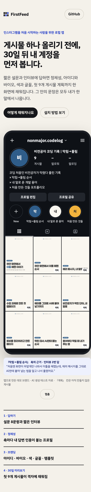

# 2026-10-22-03 · 소개 페이지 — 사용자 시안 + 앱으로 만든 데모 브랜드 · Pages 배포

| 항목 | 내용 |
|---|---|
| 세션 ID | `6887510c-f5b2-49b7-a2cf-d074e050fe51` (같은 세션) |
| 시간 | 2026-10-22 새벽 KST |
| 도구 · 모델 | Claude Code · Opus 5.5 |
| 목표 | 대회 첫인상 · 서면 평가 대비 한 페이지 소개 사이트(지시 E — 사용자 히어로 시안 출발) |
| 커밋 | `c2cf1ac` 데모 페르소나 · `a4f0039` 내보내기 스크립트 · `a0e4e4c` 결정 · `7317392` site/ · `1d1d33e` Pages · README · `74cb360` 미리보기 정리 · 이 devlog |

## 한 일

1. **시안 그대로 옮김**: `site/reference/hero-reference.html`(사용자 파일)을 끝까지 읽고 `site/index.html` 로 그대로 복사 — 디자인 · 모션 · 문구 안 바꿈. 화면 데이터는 시안의 `loadDemo()` 가 `site/data/demo.json` 으로 덮어쓴다. 시안의 안내(인스타 로고 · 인증 배지 · 무지개 테두리 · 고유 아이콘 없음, 팔로워 · 팔로잉 「–」)는 시안이 이미 지키고 있어 그대로
2. **데모 브랜드를 앱으로 실제로 만듦** — 콘셉트 「AI·개발을 처음 기록하는 사람」
   - 입력: AI 생성 페르소나 `tests/fixtures/generated/interviews/demo.json`(가상의 비전공 대학생, 설문 8 + 측정과 같은 고정 질문 5개의 답) · 소재 `tests/fixtures/generated/sources/demo-first-webpage.md`. 운영자 본인 자료(real/me)는 쓰지 않았다
   - 흐름: 임시 데이터 폴더에 설문 · 답한 인터뷰를 넣고(측정과 같은 방식 — 꼬리질문 AI 왕복은 생략) → **앱 API 를 화면과 같은 순서로**: 프로필 만들기 → 확정 → 브랜딩 글 · 시각 → 선택(늘 첫 후보) → 템플릿 A 고정(칸 예산 측정) → 소재 → 표지 후보 → 첫 후보로 본문 → 30일 계획(활성 v1) → 계획 칸 표지 8개
   - `#측정` **AI 호출 10회, 재작성 0**: 프로필 2(생성 32.2초 + 자기 평가 20.4초) · 브랜딩 글 2(40.4 + 13.3) · 시각 1(45.5) · 표지 후보 2(32.0 + 19.5) · 본문 2(41.6 + 13.9) · 시리즈 계획 1(26.6). 계획 칸 표지 · 템플릿 고정은 AI 없음
   - 결과: `nonmajor.codelog` · 「비전공자 코딩 기록 | 막힘→풀림」 · 팔레트 「노트 위 파란 펜」 · 축 3개(막힘→풀림 순서 / 내 말로 푼 용어 / 처음 만든 것들) · 격자 = 만든 카드 1 + 계획 8
3. **내보내기 `npm run export:demo-site`**(`scripts/export-demo-site.ts`): 활성 프로필 · 브랜딩 선택 · 미리보기 격자(앱과 같은 `composeGrid`)에서 `site/data/demo.json` · `site/img/tile-1..9.png`(격자처럼 양옆 34px 를 가린 3:4, 너비 506px). 값은 DB 에서만:
   - `category` 는 앱에 없는 값이라 **빈칸**, 프로필 사진은 올린 것이 없어 **이름 첫 글자 + 주색**(둘 다 DB 값), 하이라이트 = 축 이름(표시 글자는 이름 첫 글자), 팔레트 = 키트 다섯 색에서 짝지은 세 쌍
   - 근거 칩: 시안 예시는 「바이오의 근거 · 인터뷰 답 N번」이지만 **바이오에는 근거가 저장되지 않는다** → 축에 붙은 인터뷰 답 인용(코드가 원문 부분 문자열로 확인해 저장한 것)을 「「막힘→풀림 순서」 축의 근거 · 인터뷰 2번 답」으로 밝혔다
   - 쓰기 전 개인정보 검사(redact 규칙), 그림 9개는 직접 열어 확인(데모 브랜드 글자뿐)
4. **Pages 배포 워크플로** `.github/workflows/pages.yml` + README 맨 위 링크. 푸시는 됐지만 **배포는 실패**(아래)
5. 보고서 그림 목록에 「5 · 소개 페이지 정지 화면 + 링크 · QR」, 최종발표-준비에 「같은 모션을 15초 영상으로」 후보

## 화면 확인 (로컬 서버로 site/ 를 열어 Playwright 로)

- 데스크톱 1280px · 모바일 390px(배율 2) · 움직임 줄이기 — 셋 다 격자 그림 9개 모두 불러옴, 페이지 오류 · 실패한 요청 0
- 데스크톱(약 8초, 근거 칩까지 나온 때): 
- 모바일: 

## 결정

`#결정` CLAUDE.md 「2026-10-22 · 소개 페이지」 — site/ 정적 · Pages · 시안 그대로 · 데모는 AI 생성 페르소나를 앱으로 만든 결과만 · 고정 질문 5개

## 오류 → 원인 → 해결

`#트러블슈팅`
- **Pages 배포 실패** — `actions/configure-pages` 가 「Get Pages site failed. Please verify that the repository has Pages enabled and configured to build using GitHub Actions」(Pages API 404). 저장소에 Pages 가 켜져 있지 않아서 / 해결은 사용자: **Settings → Pages → Build and deployment → Source 를 「GitHub Actions」** 로 바꾼 뒤 **Actions → Pages → Run workflow**(또는 `site/` 를 바꿔 푸시). `GITHUB_TOKEN` 으로는 Pages 를 켤 수 없어(관리자 권한 필요) 워크플로에서 켜지 않았다
- **「monogram」 프로필 사진 값이 앱에 없다** — 데모 브랜딩을 고를 때 `프로필 사진: 올린 파일을 찾지 못했습니다` 로 거절. 앱의 글자형 시안은 브라우저에서 그림으로 그려 올리는 것이라 저장값은 파일 이름뿐 / 해결: 데모는 사진 없이(null), 미리보기 화면의 쓰이지 않던 「monogram」 갈래를 지움(`74cb360`) — 그 갈래는 마이그레이션 005 의 주석(「'monogram' 또는 data/brand-assets 안 파일 이름」)을 믿고 만든 것이었다. 실제 코드와 다른 주석이지만 적용된 마이그레이션 파일은 고치지 않는다(겪은 오류 2026-10-14)
- 커밋 메시지(`7317392`)에 「그림 9개는 직접 열어 확인」이라고 쓴 시점엔 2개만 따로 열고 나머지는 사이트 캡처로만 봤다 — 푸시 전에 나머지 7개를 한 장으로 모아 열어 확인했다(내용 문제 없음)

## 확인 못 한 것

- 실제 배포된 주소가 열리는지(Pages 를 켜야 함)
- 시안 문구 「그 안의 문장은 모두 내가 한 말에서 나옵니다」 — 바이오 · 계획 제목은 AI 가 쓴 문장이고, 코드가 확인하는 것은 숫자 · 영문 이름 근거와 축 인용이다. 문구는 사용자 시안이라 바꾸지 않았다 — 표현을 그대로 둘지는 **사용자 확인 필요**
- QR 이미지(만드는 도구가 레포에 없음)
- 계획 칸 2번 「하얀 화면에서 이틀 헤맨 순서」가 이미 만든 카드 「…이틀 헤맨 이야기」와 겹친다 — 계획과 만든 세트를 잇지 않는 알려진 한계(CLAUDE.md 2026-10-21)

## 다음에 할 것

- [ ] Pages 켜기 → 워크플로 다시 실행 → 주소 확인 **(사용자)**
- [ ] 보고서용 정지 화면 · QR **(사용자)**
- [ ] 히어로 문구 확인(위) **(사용자)**
- [ ] (앞선 지시 E 의 나머지 — 문제 3개 카드 · 「믿을 수 있는 이유」 모션 섹션은 이번 시안에 없어 만들지 않았다. 필요하면 시안을 받아 더한다)
