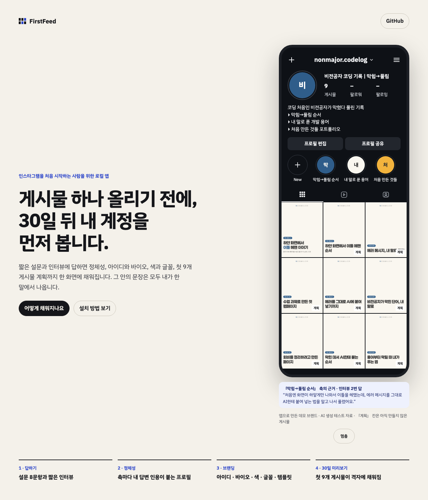

# 2026-10-22-04 · 소개 페이지 배포 확인 · 시리즈 계획 v3 활성

| 항목 | 내용 |
|---|---|
| 세션 ID | `6887510c-f5b2-49b7-a2cf-d074e050fe51` (같은 세션) |
| 시간 | 2026-10-22 새벽 KST |
| 도구 · 모델 | Claude Code · Opus 5.5 |
| 목표 | ① 사용자가 켠 Pages 로 소개 페이지가 실제로 열리는지 ② series_plan v3(근거 없는 사실 금지)를 재고, 지어낸 사실이 없으면 활성 |
| 커밋 | `9ca448a` v3 · `2610178` 결정 · `0416ac9` config · `96c1356` Pages 다시 배포 · `8326f5a` demo.json 빠진 것 · 이 devlog |

## ① 소개 페이지 배포

- 로그인한 `gh` 가 없어 `workflow_dispatch` 를 부를 수 없어, 워크플로 주석을 사실대로 고친 푸시(`96c1356`)로 다시 돌렸다 → **Pages 성공, https://djkdb.github.io/FirstFeed/ 200**
- 그런데 `data/demo.json` 이 **404** — `.gitignore` 의 `data/`(로컬 앱 데이터 폴더용)가 `site/data/` 까지 막아 **demo.json 이 커밋에 없었다**(`git check-ignore` 로 확인). 그동안 배포된 페이지는 시안에 들어 있는 **지어낸 예시 계정**(minjun.builds · 색 블록)으로 보였다 — 01:56 배포부터 02:00 무렵 다음 배포까지 약 4~5분
- 해결 `8326f5a`: 규칙을 저장소 맨 위 `/data/` 로 좁히고(로컬 DB `data/firstfeed.sqlite` 는 그대로 막힘 확인) 내보낸 demo.json 을 넣음 → 다시 배포 성공, demo.json 200
- `#측정` 실제 주소를 Playwright 로 열어 확인: 데스크톱 1280 · 모바일 390 모두 **아이디 `nonmajor.codelog`, 격자 그림 9개 중 9개 불러옴, 400 이상 응답 · 페이지 오류 0**
  - 데스크톱(근거 칩이 나온 끝 상태): 
  - 모바일: 
- 첫 캡처는 시안 모션의 「휴대폰이 흐려지는」 순간(반복 직전)에 찍혀 다시 찍었다 — 오류 아님(시안 동작)

## ② 시리즈 계획 v3

`#프롬프트` `#측정` v2 + 한 줄 「프로필·브랜딩·사용자가 직접 쓴 답에 없는 사실(자격·경력·경험·성과)은 제목에 넣지 않는다」. 같은 공개 fixture `me` · 같은 고정 템플릿(C, 18자) · 새 임시 DB, **1회 · 규칙 첫 통과 · 28.2초**(v2 는 2026-10-22-02 의 1회, 31.0초)

| # | v2 (2026-10-22-02) | v3 |
|---|---|---|
| 1 | 직접 써 본 새 도구 · 설치는 했는데 뭐부터 하지? | 직접 써 본 새 도구 · AI 도구, 설치만 하고 멈췄다면 |
| 2 | AI로 만든 것 · 코딩 몰라도 AI로 만들어 봤다 | AI로 만든 것 · 설명 말고 직접 만든 걸로 |
| 3 | 대외활동 기록 · 대외활동, 계정이 이력서가 될까 | 대외활동 기록 · 계정이 대외활동으로 이어질 때 |
| 4 | 직접 써 본 새 도구 · 공식 문서 먼저, 소문은 나중에 | 직접 써 본 새 도구 · 새 도구 첫날, 다들 하는 실수 |
| 5 | AI로 만든 것 · 바이브코딩, 어디서 막혔냐면 | AI로 만든 것 · 바이브코딩, 첫 화면은 뭐부터? |
| 6 | 직접 써 본 새 도구 · 새 도구, 다 써 봐야 할까? | 직접 써 본 새 도구 · 소문 말고 공식 문서로 확인한 것 |
| 7 | 대외활동 기록 · 자격증 말고 써 본 기록으로 | 대외활동 기록 · 협업은 어디서 시작됐을까 |
| 8 | AI로 만든 것 · 만들다 만 것도 보여 줄게요 | AI로 만든 것 · 완성 화면 뒤에 숨은 과정 |
| 9 | 직접 써 본 새 도구 · 기능 소개 말고 오늘 바꿀 하나 | 직접 써 본 새 도구 · 업데이트 떴는데 뭐가 바뀐 거지? |

- **사람이 읽고 판정(나 — 한 사람 · 1회)**: v3 의 9개에 프로필에 없는 자격·경력·경험·성과 주장이 없다. 「설치만 하고 멈췄다면」 「업데이트 떴는데 뭐가 바뀐 거지?」는 보는 사람의 상황·질문이라 계정 주인의 사실 주장이 아니고, 「협업」「대외활동」「공식 문서」「다들 하는 실수」「과정·비하인드」는 프로필 축 설명에 있다
- v2 에서 문제였던 것: 7번 「자격증」(프로필에 없음). 다시 읽으니 2번 「코딩 몰라도」(계정 주인이 코딩을 모른다는 주장 — 프로필은 「전공자가 아니어도 따라 할 수 있게」로 보는 사람 쪽 말), 8번 「만들다 만 것도 보여 줄게요」(하지 않은 약속 — 바이오의 결정 2026-10-14 와 같은 모양)도 같은 계열이었다
- **결정: 활성 판 v3**(사용자 조건 충족) — CLAUDE.md `2610178`, config `0416ac9`(활성 판 전체를 지키는 `config.test.ts` 에 series_plan 추가). 이 금지는 프롬프트에만 있고 코드 규칙은 아니다
- 1회라 「v3 가 늘 지어내지 않는다」는 말할 수 없다

## 오류 → 원인 → 해결

`#트러블슈팅`
- **넓은 무시 규칙(`data/`)이 새 폴더의 공개용 파일을 조용히 뺐다** — 증상: 배포는 성공인데 페이지가 시안의 지어낸 예시로 보임(demo.json 404) / 원인: `.gitignore` 의 `data/` 가 어느 깊이든 `data` 폴더를 막음. `git add site` 가 오류 없이 넘어가 몰랐다 / 해결: `/data/` 로 좁힘 / 다시 안 겪으려면: 새 폴더를 커밋한 뒤 `git ls-files <폴더>` 로 들어간 파일을 센다. 배포 확인은 「200」이 아니라 **화면에 무엇이 보이는지**(아이디 · 그림 수)로 한다
- 커밋 전 훅이 첫 커밋(v3 프롬프트만)을 막음 — 작업 트리에 이미 config 변경이 있어 활성 판 테스트가 실패. 훅은 작업 트리로 테스트한다 / 해결: 테스트를 함께 고친 뒤 차례로 커밋

## 다음에 할 것

- [ ] 소개 페이지의 계획 칸은 v1 으로 만든 것이다 — v3 로 다시 만들려면 데모 데이터 폴더에서 계획 1회(AI) + `npm run export:demo-site`. 하지 않았다(지시 밖) **(사용자 결정)**
- [ ] 보고서 그림 5(정지 화면 · QR) **(사용자)**
