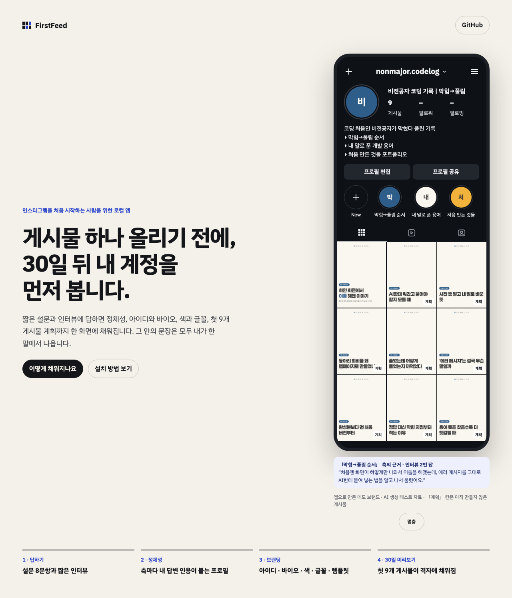
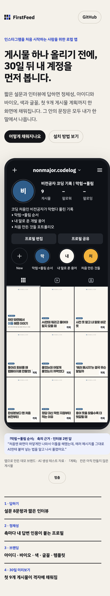
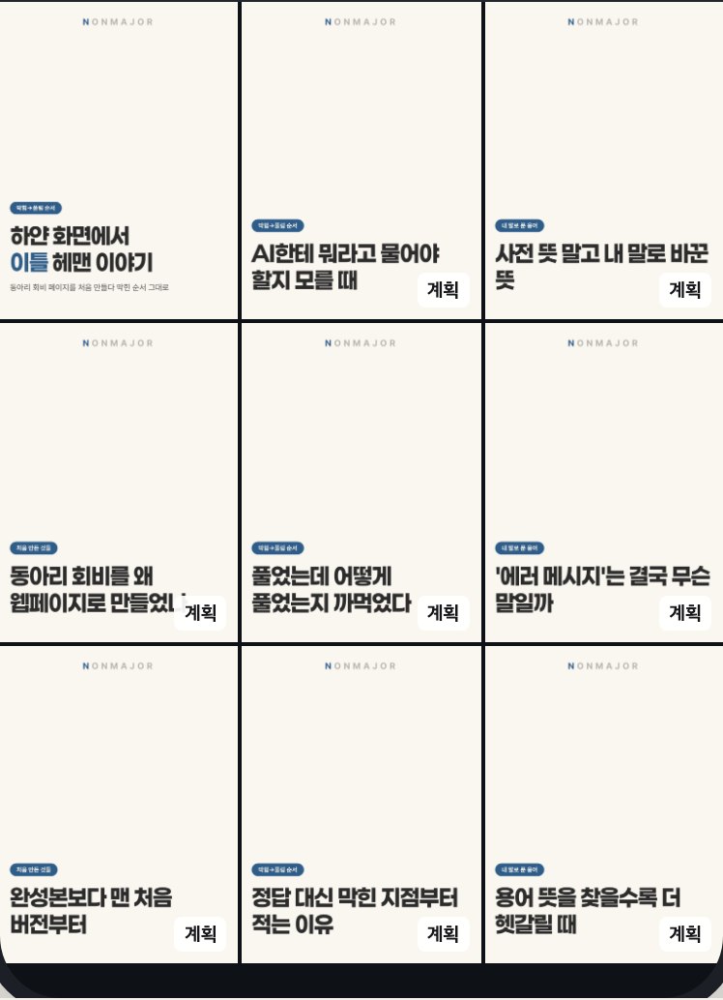

# 2026-10-24-01 · 시리즈 계획 제목 겹침 — 만든 카드 입력 · 겹침 규칙 · v4 · 소개 페이지 다시 내보내기

| 항목 | 내용 |
|---|---|
| 세션 ID | `6887510c-f5b2-49b7-a2cf-d074e050fe51` (같은 세션) |
| 시간 | 2026-10-24 저녁 KST |
| 도구 · 모델 | Claude Code · Opus 5.5 |
| 목표 | 소개 페이지 데모 격자의 제목 겹침(1번 만든 카드 「하얀 화면에서 이틀 헤맨 이야기」 ≈ 2번 계획 「…이틀 헤맨 순서」, 「내 말로」 3·6·9번, 「AI에 붙여 넣기 / AI한테 묻는」 5·8번)을 실제 사용자도 겪을 **제품 버그**로 고친다(사용자 지시) |
| 커밋 | `696620d` v4 + 입력 · `ca73d75` 겹침 규칙 · `c5dfd58` 결정 · `323067a` PRD · `83c69ce` config v4 · `64cffd7` 소개 페이지 · `95f37d0` status · `13ab3df` 보고서 · 이 devlog |

## 원인

계획 프롬프트(v1~v3)는 **이미 만든 카드 세트를 몰랐다.** 프로필 축 설명과 인터뷰 답에서 소재를 고르니, 그 답으로 이미 만든 카드(하얀 화면 이야기)와 같은 소재가 계획으로 다시 나왔다. 코드 규칙에도 제목끼리 비교가 없었다.

## 한 일

1. **입력**(`696620d`): `plan.ts` 가 `listSets` 의 표지 제목(강조 `**` · 줄바꿈 뺀 글)을 `PlanContext.madeTitles` 로, 프롬프트 `{{made}}` 로 넘긴다. `made` 는 선택 변수라 v1~v3 로 비교 측정해도 같은 코드로 돈다
2. `#프롬프트` **v4** = v3 + 「이미 만든 게시물과 같은 소재·같은 표현을 반복하지 않는다. 제목끼리도 핵심 표현을 겹치지 않는다」 + 「이미 만든 게시물 (표지 제목, 최신순)」 절
3. **코드 규칙**(`ca73d75`): `title_like_made`(만든 표지와) · `title_like_other`(계획끼리, 뒤 칸을 고치게). 잣대는 질문 중복 · 축 겹침이 쓰는 글자 두 개 묶음 겹침(`rules/similarity.ts`, 자카드). 사용자가 고정한 칸은 사용자 글이라 고치라고 하지 않는다(겹치는 AI 칸이 걸린다). 사용자가 직접 고친 제목에는 걸지 않는다
4. 테스트(`preview.test.ts`): 데모 1·2번 걸림 · 계획끼리 뒤 칸 · 데모 3~9번 + 공개 fixture me 의 v3 9개는 통과 · 고정 칸 · API 에서 재작성 1번 · v4 프롬프트에 만든 제목이 들어감

## 기준값 0.4 를 정한 과정

`#측정` 지금 있는 실제 계획 4벌(데모 격자 + me 의 v1 · v2 · v3), 각 36쌍 = 144쌍을 같은 함수로 쟀다:

| 쌍 | 겹침 |
|---|---:|
| 데모 1·2 「하얀 화면에서 이틀 헤맨 이야기 / …순서」 (거의 같음) | **0.643** |
| 데모 4·7 「수업 과제로 만든 첫 웹페이지 / 회비를 정리하려고 만든 페이지」 (다른 소재, 「만든 페이지」만 겹침) | 0.150 |
| 데모 3·6 「에러 메시지, 내 말로 풀면 / 비전공자가 막힌 단어, 내 말로」 (「내 말로」만 겹침) | **0.111** |
| me v1 1·2 「새 AI 도구, 처음 켜면 할 일 / ZUN이 AI로 처음 만든 것」 (다른 소재) | 0.105 |
| me v2 · v3 의 가장 높은 쌍 | 0.050 · 0.053 |

- 판단: 제목이 짧아(글자 두 개 묶음 10개 남짓) **두 낱말 표현 하나만 겹쳐도 0.1~0.15** 가 나온다. 3·6번(0.111)을 잡으려면 기준을 0.1 근처로 내려야 하는데, 그러면 다른 소재 쌍(0.105 · 0.150)도 같이 걸려 정상 계획이 재작성 2회를 다 쓰고 실패할 수 있다(opus 1회 약 30초). → **3·6번 같은 표현 반복은 프롬프트(v4)에 맡기고, 코드는 거의 같은 제목만** — 0.150 과 0.643 사이의 **0.4**
- 표본이 4벌뿐이다. 거의 같은 쌍은 하나(0.643)라 0.4~0.6 사이 어디가 맞는지는 이 자료로 가를 수 없다
- 알려진 한계: **같은 소재를 다른 말로 쓴 제목은 못 잡는다** — 아래 v3 1번 「화면이 하얗게만 나온다면」은 만든 카드와 소재가 같은데 겹침 0.048

## v3 / v4 나란히 (데모 브랜드, 각 1회)

`#측정` 데모 데이터 폴더를 두 벌 복사해 활성 판만 바꾸고, **재작성 0**(`ai.maxRewrites`)으로 두어 첫 출력의 규칙 위반을 그대로 셌다. 같은 프로필 · 키트 · 고정 템플릿 A · 만든 카드 1개

| | v3 | v4 |
|---|---|---|
| 호출 · 결과 | 1회 · 규칙 첫 통과 · 34.6초 | 1회 · 규칙 첫 통과 · 33.4초 |
| **겹침 규칙 위반** | **0** | **0** |
| 계획끼리 가장 높은 겹침 · 만든 표지와 가장 높은 겹침 | 0.045 · 0.048 | 0.043 · 0.000 |

| # | 축 | v3 | 축 | v4 |
|---|---|---|---|---|
| 1 | 막힘→풀림 | 화면이 하얗게만 나온다면 | 막힘→풀림 | AI한테 뭐라고 물어야 할지 모를 때 |
| 2 | 내 말로 | 에러 메시지는 무슨 말을 하는 걸까 | 내 말로 | 사전 뜻 말고 내 말로 바꾼 뜻 |
| 3 | 처음 만든 것 | 거창한 앱 말고 동아리 회비 페이지 | 처음 만든 것 | 동아리 회비를 왜 웹페이지로 만들었나 |
| 4 | 막힘→풀림 | AI한테 뭐라고 물어야 하지? | 막힘→풀림 | 풀었는데 어떻게 풀었는지 까먹었다 |
| 5 | 내 말로 | 개발 용어, 사전 말고 내 말로 | 내 말로 | '에러 메시지'는 결국 무슨 말일까 |
| 6 | 처음 만든 것 | 수업 과제가 첫 포트폴리오가 될 때 | 처음 만든 것 | 완성본보다 맨 처음 버전부터 |
| 7 | 막힘→풀림 | 풀어 놓고 방법을 잊어버린 적 | 막힘→풀림 | 정답 대신 막힌 지점부터 적는 이유 |
| 8 | 내 말로 | 모르는 단어, 검색할까 물어볼까 | 내 말로 | 용어 뜻을 찾을수록 더 헷갈릴 때 |
| 9 | 처음 만든 것 | 잘 만든 것보다 처음 만든 것 | 처음 만든 것 | 과제로 만든 게 첫 포트폴리오? |

- **사람이 읽고 판정(나 — 한 사람 · 1회)**: 만든 카드는 「하얀 화면 → 개발자 도구의 에러 메시지 → 그대로 AI에 붙여 넣기」다
  - **만든 카드 소재를 다시 꺼낸 제목**: v3 1번 「화면이 하얗게만 나온다면」(같은 소재) — v4 는 없음. 둘 다 「에러 메시지」(v3 2 · v4 5) · 「AI한테 묻기」(v3 4 · v4 1)는 남았다 — 만든 카드의 일부이자 축 설명(「AI한테 물어 가며」)의 중심이라 겹침인지 축인지 가르기 어렵다
  - **계획끼리 핵심 표현 반복**: v3 「물어」 4·8, 「~말고」 3·5 / v4 「뜻」 2·8, 「~때」 1·8 — 비슷하다
  - 지어낸 사실: v4 4번 「까먹었다」는 인터뷰 1번 답 「어떻게 풀었는지 금방 잊어버리더라고요」, 「포트폴리오」「회비」「동아리」는 설문 · 인터뷰 답에 있다. 둘 다 지어낸 자격 · 경력 · 경험 · 성과 없음
- **결정: v4 활성**(사용자 조건 「v4 가 겹침이 적으면」) — 규칙 위반은 둘 다 0 으로 같고, 사람이 읽은 만든 카드 소재 반복이 v3 1 → v4 0. **한 칸 차이 · 1회씩**이라 「v4 가 늘 덜 겹친다」고는 말할 수 없다. CLAUDE.md `c5dfd58` · PRD `323067a` · config `83c69ce`

## 소개 페이지 다시 내보내기

- 데모 브랜드 계획은 **위 v4 회차를 그대로** 썼다 — 앱의 `generatePlan` 경로로 활성 판 v4 가 1회에 규칙을 통과했으므로(재작성 0 설정은 결과에 영향 없음) AI 를 한 번 더 부르지 않았다. 측정용으로 바꾼 설정 두 개(재작성 0 · 활성 판)는 지운 뒤 `npm run export:demo-site` → 격자 9칸(만든 1 · 계획 8). 바뀐 것은 계획 칸 제목 8개와 그 그림뿐(`64cffd7`). v1 계획이 든 옛 데모 데이터 폴더는 따로 남겨 뒀다(레포 밖)
- 그림 9개를 한 장으로 모아 열어 확인 — 잘림 없음, 9칸 서로 다른 제목. 3번 「사전 뜻 말고 내 말로 바꾼 / 뜻」은 마지막 한 글자만 둘째 줄로 갔다(넘침 아님, 보기만 어색)
- `#측정` 배포: Pages · CI 모두 success(`64cffd7`). 실제 주소를 Playwright 로 열어 데스크톱 1280 · 모바일 390 모두 **아이디 `nonmajor.codelog`, 그림 9/9, 400 이상 응답 · 페이지 오류 0**, 배포된 demo.json 의 제목 9개 = 만든 카드 1 + 위 v4 의 1~8번(9번은 칸이 모자라 격자에 안 나옴)
  - 데스크톱: 
  - 모바일: 
  - 격자 확대(배율 2): 
- **새로 보인 것**: 4번 칸 「동아리 회비를 왜 웹페이지로 만들었나」의 마지막 글자를 소개 페이지의 「계획」 배지(시안 CSS `.badge` 오른쪽 아래)가 가린다. 앱 미리보기의 배지는 오른쪽 위(`.ig-badge`)라 앱에는 없는 문제. 시안의 디자인은 그대로 둔다는 지시라 고치지 않았다 — **사용자 확인 필요**(배지를 오른쪽 위로 옮기는 한 줄)

## 보고서 (`13ab3df`)

- 소개 페이지 주소 · 그림 5(열림 · 새 확인 캡처 · 배지 가림) · M 끝남 18(그대로) · 프롬프트 17종 31판(10-22 의 28판에 series_plan v2 · v3 · v4) · ③ 에 시리즈 계획 v1 → v2 → v3 → v4 사례 표
- `#측정` 분량 다시 셈: ① 2,513 · ② 1,160 · ③ 1,360 · ④ 544 = **5,577자 → 약 5.2쪽**(쪽당 1,500자 · 그림 반 쪽은 가정값). **5쪽을 넘는다(추정)** — 줄일 후보 ⓐ~ⓖ 를 적었고 고르는 것은 사용자. 세는 법은 10-22 와 같게 다시 짰고, 그 스크립트를 10-22 판에 돌리면 4,721자(기록 4,692자, 1% 안)

## 결정

`#결정` CLAUDE.md 「2026-10-21 · 30일 뒤 내 계정 미리보기」 아래 — 겹침 규칙 0.4 와 근거 · 같은 소재를 다른 말로 쓴 제목은 못 잡는 한계 · 활성 판 v4. 「같은 소재여도 이어 붙이지 않는다」 줄은 줄을 긋고 바뀐 점을 적음. status.md 의 FR-BR-6 은 끝남 그대로, 수용 기준이 늘어 근거 · 날짜를 `696620d` · `ca73d75`(2026-10-24 21:31)로

## 오류 → 원인 → 해결

`#트러블슈팅`
- 커밋 전 개인정보 검사가 테스트를 막음 — 테스트 기대값을 「규칙 코드 + 골뱅이 + 칸 위치」로 이어 써서 이메일 모양이 됐다 / 해결: 공백으로 이음(허용 목록에 올리지 않음). 이 devlog 에 처음엔 그 문자열을 그대로 옮겨 적어 한 번 더 막혔다 — 「겪은 오류」의 「오탐을 설명하려고 걸린 문자열을 그대로 옮겨 적으면 다시 걸린다」와 같은 모양
- 측정 결과 파일 첫 줄에 어댑터 로그(`[AI] series_plan #1 …`)가 섞여 JSON 읽기가 실패 — 마지막 줄만 읽음(측정 스크립트는 레포 밖 임시 파일)

## 확인 못 한 것

- 0.4 가 다른 브랜드 · 더 많은 계획에서도 정상 계획을 막지 않는지 — 실제 계획 4벌로만 쟀다
- v4 가 반복해서도 만든 카드 소재를 피하는지(1회)
- 실제 PDF 쪽수(가정값으로 추정)

## 다음에 할 것

- [ ] 소개 페이지 4번 칸 배지 가림 — 시안의 배지를 오른쪽 위로 옮길지 **(사용자)**
- [ ] 보고서 줄일 곳 고르기(ⓐ~ⓖ) **(사용자)**
- [ ] 그림 5 — 이번 확인 캡처를 써도 되는지, QR **(사용자)**
