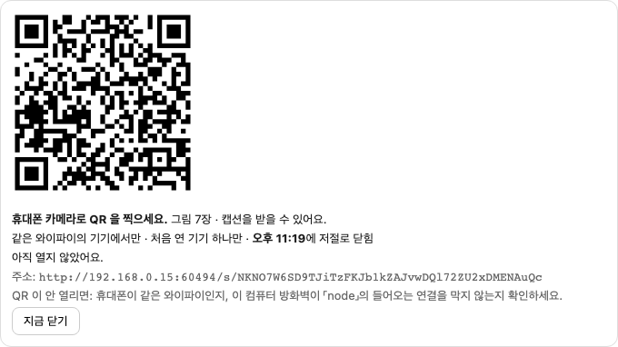
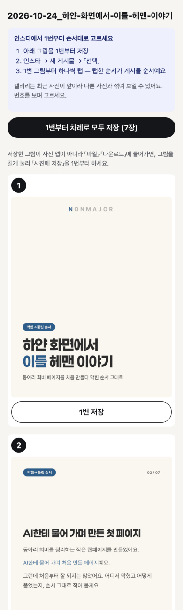
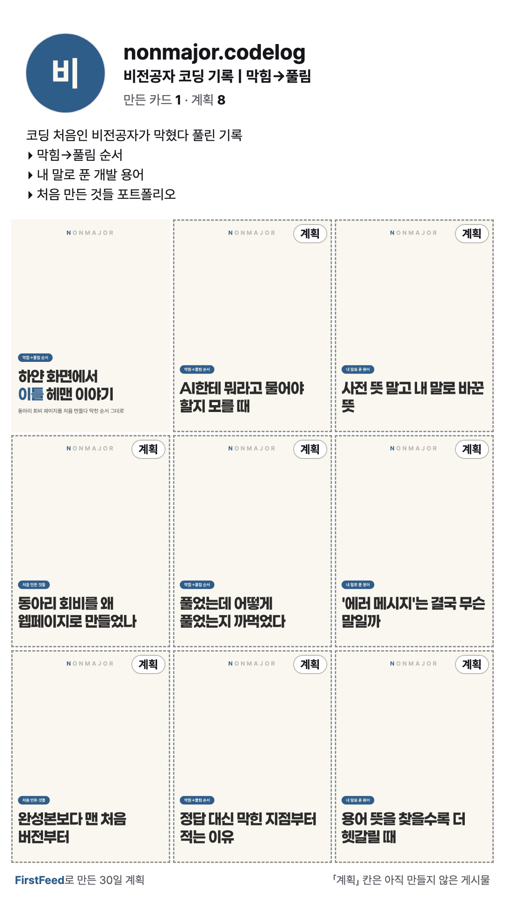

# 2026-10-24-02 · 폰으로 받기(QR) · 30일 뒤 내 계정 공유 이미지 · 사용자 경험 설계서

| 항목 | 내용 |
|---|---|
| 세션 ID | `6887510c-f5b2-49b7-a2cf-d074e050fe51` (같은 세션) |
| 시간 | 2026-10-24 밤 KST |
| 도구 · 모델 | Claude Code · Opus 5.5 |
| 목표 | 방향 「보안·유지보수보다 사람들이 실제로 쓰고 싶은 매력 먼저」(사용자 지시) — 작은 것 2개 구현(폰으로 받기 · 공유 이미지), 큰 것 2개 설계만(「오늘 올릴 것」 홈 · 실시간 미리보기), 보고서 ④ 두 줄 |
| 커밋 | `8bdaa6e` 폰으로 받기 · `5570514` 공유 이미지 · `c8b697e` 결정 · `1955f12` PRD · `5dd88ee` status · `59ce8e1` 설계서 · `9d08fde` 보고서 · `3799335` 번호 자리 · 이 devlog |

## 1. 폰으로 받기 (FR-PB-5) — `8bdaa6e` · `3799335`

- 업로드 준비의 만든 폴더마다 「폰으로 받기」 → QR · 주소 · 「같은 와이파이의 기기에서만 · 처음 연 기기 하나만 · HH:MM 에 저절로 닫힘」 · 열었는지 · 「지금 닫기」(`app/src/cards/PhoneShare.tsx`)
- 휴대폰 페이지: 1번부터 번호 · 「n번 저장」 · 「1번부터 차례로 모두 저장」 · 캡션 복사(보안 연결이 아니라 `navigator.clipboard` 가 없을 때는 글 상자 선택 + 복사로) · 「인스타에서 1번부터 순서대로 고르세요 — 「선택」 → 1번부터 탭, 탭한 순서가 게시물 순서」(휴대폰 업로드 확인 2026-10-21 그대로)
- `#결정` **보안 설계**(CLAUDE.md 「2026-10-24 · 폰으로 받기 · 공유 이미지」에 이유): 본 서버는 그대로 127.0.0.1 · 같은 네트워크에는 따로 켠 작은 서버(`server/src/publish/phone-share.ts`)만 — 버튼을 눌렀을 때만 · 켤 때 찍은 그 폴더의 카드 그림 이름 + 캡션.txt 만 · GET/HEAD 만 · 32바이트 토큰(일정 시간 비교) · Host 확인 · 처음 연 기기 하나 · 10분(`publish.phoneShareMinutes`) · 사설 IPv4 하나에만
  - 「1회용」을 「요청 한 번」이 아니라 「처음 연 기기 하나 · 닫으면 끝」으로 해석했다 — 그림 여러 장을 받아야 해서
  - 알려진 한계: HTTPS 아님(같은 네트워크에서 엿들으면 그림 · 주소가 보임) · 같은 공유기 안 기기는 연결 시도는 가능(토큰 없이는 404) — **사용자 확인 필요**
- QR 은 `qrcode-generator` 2.0.4 — MIT(패키지 안 `dist/qrcode.mjs` 머리 주석에서 확인, LICENSE 파일은 패키지에 없음), 의존성 없음. `qrcode` 패키지는 명령줄용 yargs 까지 끌어와 고르지 않았다
- 테스트 `phone-share.test.ts` 15개: 토큰 없음 · 틀림 · 한 글자 짧음 → 404 / 만료 → 410 / 목록 밖 이름 · 경로 올라가기 · 심볼릭 링크 · 글 파일 · 켠 뒤 생긴 파일 · `/api/health` 같은 본 서버 경로 → 404 / POST 등 → 405 / Host 다름 → 403 / 다른 기기 → 403 / 캡션 속 `<script>` 이스케이프 · CSP / 실제로 127.0.0.1 에 켜고 → 닫은 뒤 연결 거절 · 시간 만료로 닫힘 · 다시 켜면 앞 토큰 닫힘 · 와이파이 없음 / **본 서버는 같은 네트워크 주소(192.168.x · 10.x)로 온 켜기 · 상태 · 건강 확인 모두 403**

### 화면 확인 (무엇을 실행해서 무엇을 봤나)

`#측정` 데모 데이터 복사본으로 임시 서버(4417) + 화면(5273)을 띄우고 Playwright 로:
- 만들기 → 세트 「보기」 → 「업로드 폴더 만들기」 → 「폰으로 받기」 → QR 패널(아래). 주소는 **이 맥의 실제 와이파이 주소 `192.168.0.15:<무작위 포트>`** 에 묶였다
- 그 주소를 **아이폰 13 크기 · 모바일 사파리 흉내** 브라우저로 열어: 200 · 그림 **7/7** · 「캡션 복사」 → 「복사했어요」 · 「1번 저장」 → `01_cover.png` 내려받기 · 컴퓨터 패널에 「휴대폰에서 열었어요」 · 「지금 닫기」 뒤 같은 주소 → `ERR_CONNECTION_REFUSED`
- 같은 컴퓨터라 **1회용(다른 기기 거절)은 실제로는 못 쟀다**(같은 IP) — 테스트로만
- 이 맥의 방화벽은 꺼져 있다(`socketfilterfw --getglobalstate`) — 켜져 있으면 처음 한 번 「node 의 들어오는 연결」을 물을 수 있다(화면 안내에 적음)
- 확인용 세트의 풀이 3개는 API 로 「확인했어요」, **캡션은 AI 를 부르지 않으려고 임시 DB 에 손으로 넣었다**(「[폰으로 받기 확인용 — 손으로 넣은 캡션]」으로 시작). 레포 데이터 아님
- 처음 그린 페이지에서 번호 배지가 2번 카드 왼쪽 위 칩을 가려 그림 앞 줄로 옮김(`3799335`) — 다시 돌려 같은 결과 확인

### 사용자가 실제 휴대폰으로 확인하는 법

1. 맥과 휴대폰을 **같은 와이파이**에 연결 → `npm run dev` → http://localhost:5173 → 만들기 → 세트 「보기」 → (캡션 · 풀이 확인) → 「업로드 폴더 만들기」 → 그 폴더 줄의 「폰으로 받기」
2. 휴대폰 카메라로 QR → 뜨는 주소 열기. 정상: 제목 · 안내 · 1번부터 카드 · 캡션 / 버그: 안 열림(같은 와이파이인지 · 맥 방화벽 확인), 그림이 비어 보임, 순서가 다름
3. 「1번 저장」 → **사진 앱에 들어가는지 · 파일 앱(아이폰) / 다운로드(안드로이드)에 들어가는지** 확인(코드로는 확인 못 함). 「차례로 모두 저장」은 안드로이드 크롬이 「여러 파일 내려받기 허용」을 물을 수 있다(확인 못 함)
4. 「캡션 복사」 → 인스타 캡션 칸에 붙여 넣어 보기(보안 연결이 아닌 주소라 복사가 안 될 수 있음 — 그때 페이지가 「길게 눌러 복사」 안내)
5. 인스타 → 새 게시물 → 「선택」 → 1번부터 탭 → 순서가 맞는지
6. **다른 기기**(다른 휴대폰)로 같은 QR → 「이미 다른 기기에서 열린 주소」가 나와야 정상
7. 컴퓨터에서 「지금 닫기」 → 휴대폰에서 새로고침 → 열리지 않아야 정상. 10분 뒤에도 같은지

## 2. 공유 이미지 (FR-BR-7) — `5570514`

- 미리보기 화면 「이미지로 저장」 → `GET /api/preview/share.png` → 1080×1920 PNG(`퍼스트피드-30일-미리보기.png`). 프로필 머리 · 「만든 카드 N · 계획 M」(팔로워 없음) · 바이오 · 격자 9칸(화면과 같은 composeGrid · 가림 · 계획 칸 표지) · **계획 칸 「계획」 배지 · 점선 그대로** · 「FirstFeed로 만든 30일 계획 · 「계획」 칸은 아직 만들지 않은 게시물」
- 카드와 같은 렌더링 경로(renderCard). 아이디 · 이름 · 바이오가 칸을 넘치면 PNG 없이 이유
- `#트러블슈팅` 첫 렌더링이 실패 — 「글자 6개가 대체 글꼴 Lucida Grande」. 데모 바이오의 「▸」(U+25B8)가 Pretendard 에 없었고, **앱에 넣은 글꼴 8개를 하나씩 그려 보니 어디에도 없었다**. 카드처럼 막으면 사용자가 바이오에 쓴 기호 때문에 공유 이미지를 영영 못 만든다 → `#결정` 이 그림만 대체 글꼴을 경고로(`allowFontFallback`, 카드는 안 씀). 처음엔 `captureEvenIfBad` 만 켰는데 renderCard 가 대체 글꼴이면 그것과 상관없이 찍지 않아 다시 실패 — 옵션을 따로 더했다
- 화면에서 눌러 받은 파일을 열어 확인(아래): 1080×1920, 계획 8칸에만 배지 · 점선, 만든 1칸은 배지 없음, 「▸」 는 대체 글꼴로 보임. 처음엔 점선이 표지 그림 아래 깔려 안 보여 그림 위로 올림
- 테스트(브라우저 4): 크기 · 9칸 미만(계획 2 + 빈칸 7) · 배지 수 · 팔로워 없음 · 바이오 넘침이면 없음 · API 내려받기. CI(우분투)에서도 통과 — 대체 글꼴 경고 테스트가 리눅스 글꼴에서도 같게 나왔다
- `composeGrid` 를 `compose-grid.ts` 로 옮김(routes ↔ share-image 고리 피하기)

## 3. 설계서 · 보고서

- `docs/service/사용자-경험-설계.md`: 「오늘 올릴 것」 홈(흐름 · 칸 상태 3가지 계획/만듦/올림 · 필요한 데이터 · FR 후보 HM-1~4) · 실시간 미리보기(시점별 AI 호출과 대기 — 측정값과 「짐작」 구분, 안 A/B, 비용 줄이는 법) · 그 밖의 후보 · 매력 / 대회 효과 / 일의 양 표. **고를 것은 0장**
- 보고서 ④ 에 두 줄(줄이지 않음) → ④ 811자, 합계 5,844자 ≈ **약 5.4쪽(가정값) — 5쪽 넘침**, 줄일 후보는 그대로 사용자 결정
- PRD: FR-PB-5 · FR-BR-7 신설 S(우선순위 사용자 확인 필요) → 65개. status: FR-PB-5 진행(실제 휴대폰 미확인) · FR-BR-7 끝남

## 오류 → 원인 → 해결

`#트러블슈팅`
- 커밋 전 개인정보 검사가 `토큰 칸에 함수 호출을 바로 넣은 줄`을 비밀 값으로 잡음(이름 붙은 비밀 값 규칙) — 오탐. 허용 목록에 올리지 않고 지역 변수 이름을 바꿈
- 타입 체크가 생성자 매개변수 속성을 막음(`erasableSyntaxOnly`, 「겪은 오류」의 실행기 둘 문제) — 일반 필드로
- 임시 서버 포트 4417 을 10-22 의 데모 서버가 아직 쥐고 있었다 — 처음 설정 요청이 그 서버(옛 데모 DB)로 갔다(임시 DB 라 피해 없음). 그 프로세스를 끄고 다시 띄움. 사용자의 리허설 서버(4317 · 5173)는 건드리지 않았고 끝에 살아 있는 것을 확인
- tsx 로 띄운 임시 서버가 SIGTERM 에 안 꺼져 SIGKILL 로 껐다 — 원인은 **확인 못 함**(개발 서버 `npm run dev` 에서 같은지도 안 봄)

## 확인 못 한 것

- **실제 휴대폰**(아이폰 · 안드로이드)으로 받기 — 위 「확인하는 법」 **(사용자)**
- 저장이 사진 앱으로 가는지 · 여러 장 내려받기 허용 묻기 · 보안 연결 아닌 주소에서 복사
- 1회용(다른 기기 거절)을 실제 두 기기로
- 공유 이미지를 실제 인스타 스토리에 올렸을 때 잘림(스토리 가림 영역은 잰 적 없음)

## 다음에 할 것

- [ ] 실제 휴대폰으로 받기 확인 **(사용자)**
- [ ] FR-PB-5 · FR-BR-7 우선순위 **(사용자)**
- [ ] 설계서 0장 고르기 **(사용자)**
- [ ] 보고서 줄일 곳 고르기(약 5.4쪽 추정) **(사용자)**
