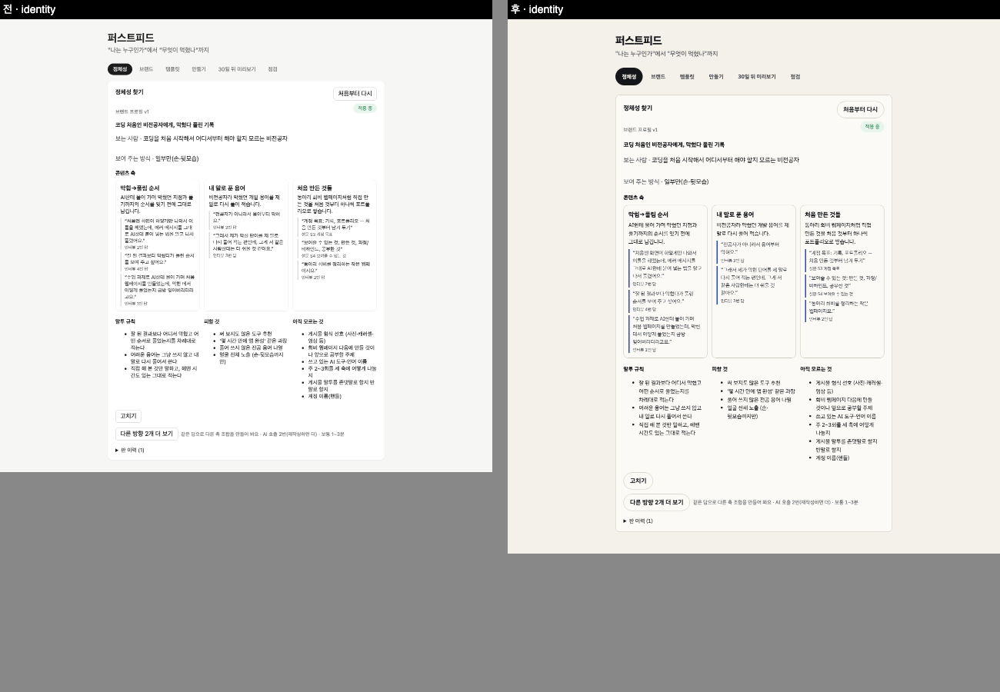
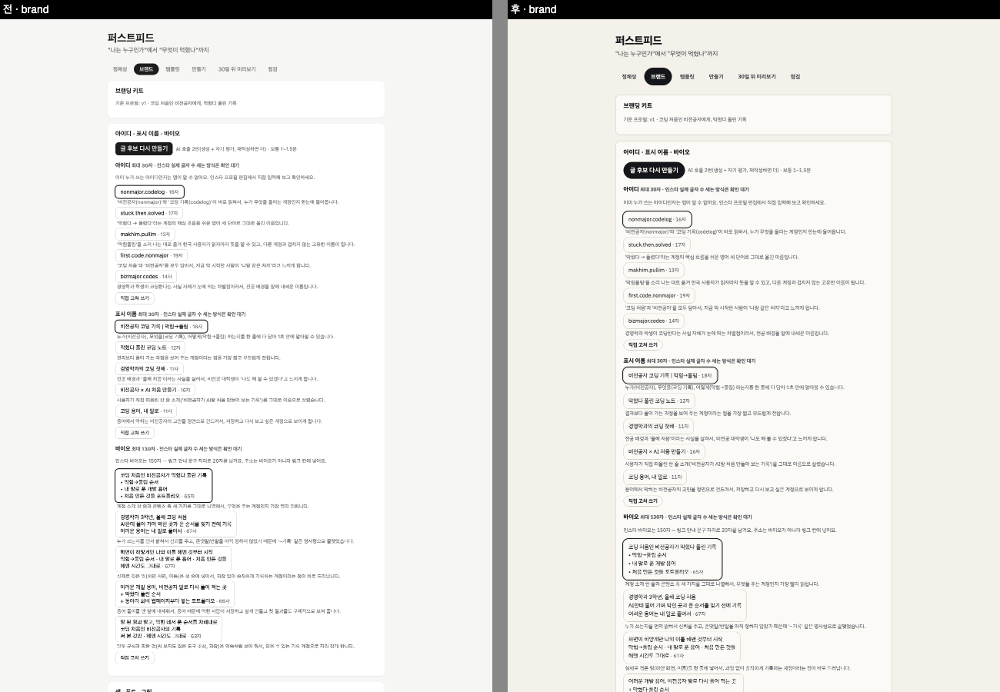
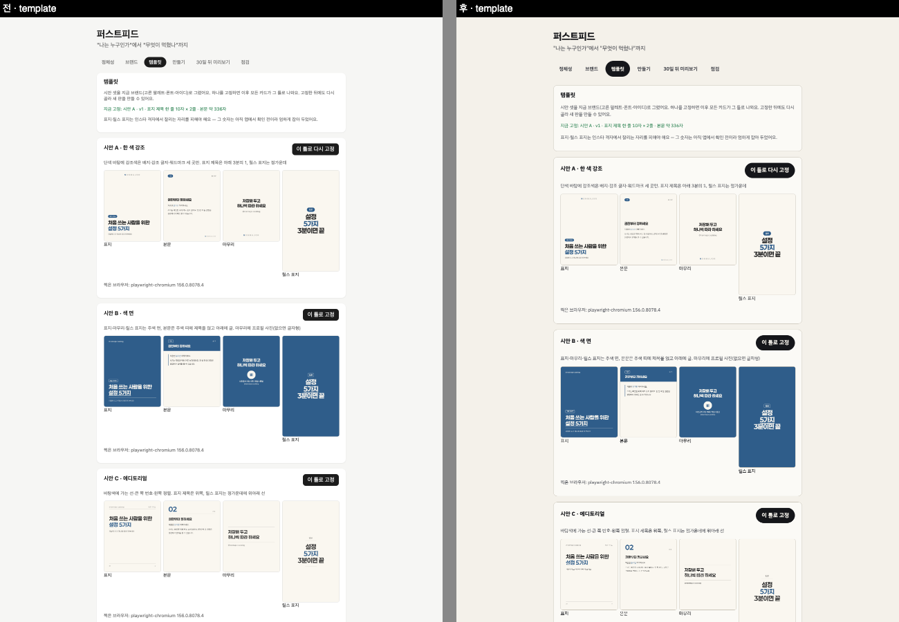
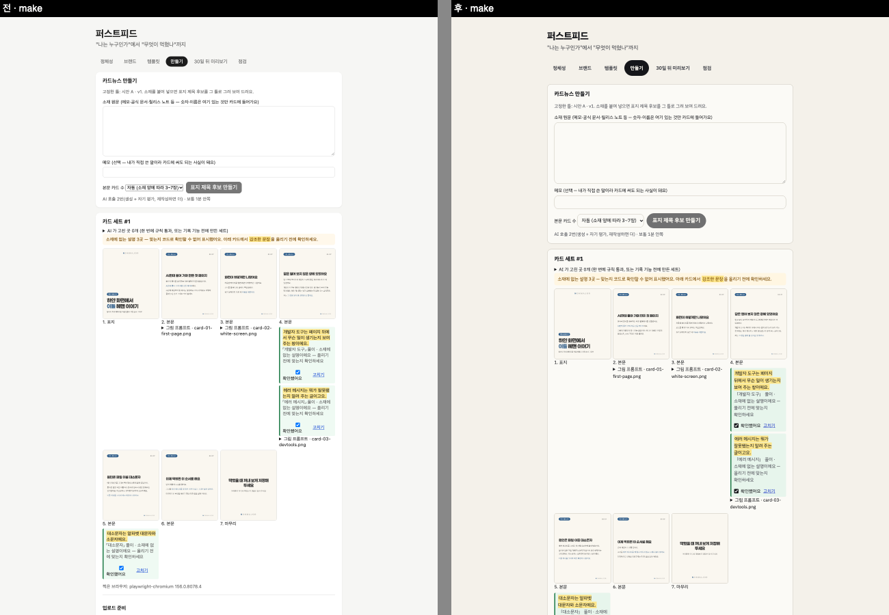
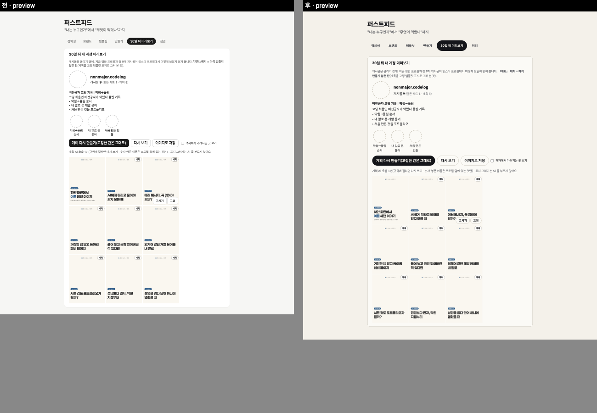
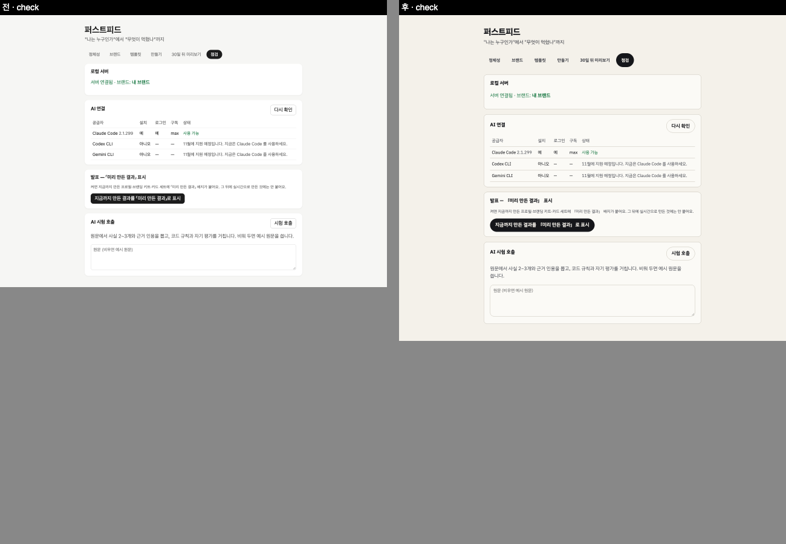

# 2026-10-24-03 · 설계서 0장 결정 반영 · 초안 호출 시간 · AI 대기 단계 표시 · 디자인 통일

| 항목 | 내용 |
|---|---|
| 세션 ID | `6887510c-f5b2-49b7-a2cf-d074e050fe51` (같은 세션) |
| 시간 | 2026-10-24 밤 ~ 10-25 새벽 KST |
| 도구 · 모델 | Claude Code · Opus 5.5 |
| 목표 | 사용자 결정 6개 반영 · 실시간 미리보기 초안 호출 시간 재기 · A AI 대기 단계 표시 · B 디자인 통일 · (C 「오늘 올릴 것」 홈은 다음 devlog) |
| 커밋 | `f66bda6` 결정 · `8fff3b7` PRD · status · `974b494` 공용 와이파이 안내 · `8c1bc19` 서비스화 계획 · `171c72b` 초안 측정 도구 · `fd82cbc` 설계서 · 보고서 · `ac8a992` A · `52b980e` B · 이 devlog |

## 결정 반영

`#결정` CLAUDE.md 「2026-10-24 · 설계서 0장 고름」(`f66bda6`)
- 순서: AI 대기 단계 → 디자인 통일 → 「오늘 올릴 것」 홈 → FR-MK-9 → 실시간 미리보기(중간 발표 뒤)
- 「오늘 올릴 것」 기본 3일마다 1개(주 2회 · 주 3회로 바꿀 수 있게) · 「올렸어요」는 사용자 표시로만 · 「하루 미루기」
- 실시간 미리보기 안 B(정해진 시점에만 초안 호출) — 지금은 시간만 잼
- FR-PB-5 **F** · FR-BR-7 **S** → PRD · status 집계 M 21 · F 14 · S 20 · W 10 = 65(`8fff3b7`)
- 폰으로 받기 화면 · 휴대폰 페이지에 「카페 같은 공용 와이파이에서는 쓰지 마세요」(`974b494`, 테스트에 한 줄)
- 「서비스화 계획」이라는 문서가 레포에 없어 `docs/service/서비스화-계획.md` 를 새로 만들고 「폰으로 받기 HTTPS 검토」를 첫 항목으로(`8c1bc19`) — 왜 지금 안 하나 · 검토할 길 3가지(모두 확인 전)
- 보고서는 줄이지 않는다 — 조판은 레포 밖, 실제 쪽수를 보고 ⓐ → ⓑ → ⓓ → ⓕ(`fd82cbc`)

## 초안 호출(안 B) 시간 — `171c72b`

`#측정` `#프롬프트` 측정용 프롬프트 `prompts/identity_sketch/v1.md`(앱에서 아직 안 씀) + `scripts/probe-sketch.ts`. 공개 fixture `me` 의 설문 + 인터뷰 앞 3개 답(「인터뷰 3번째 답 뒤」 시점), 자기 평가 없음

| 모델 | 호출 시간(첫 · 다시 · 다시) | 결과 |
|---|---|---|
| sonnet | 6.3 · 6.5 · 6.5초 | 3번째 통과 |
| haiku | 6.5 · 6.5 · 6.4초 | 3번 다 규칙에 걸려 버림 |

- 호출 한 번 ≈ **6.5초, 두 모델 같음** — 짧은 출력에서는 CLI 를 띄우는 시간이 커 보인다(짐작). 설계서의 「짐작 10~20초」를 잰 값으로 바꿈
- `#트러블슈팅` **재작성은 내 스크립트 잘못**: 근거 규칙을 아이디(늘 영문)에도 걸어 영문마다 「답에 없는 영문」이 났다 → 호출이 2번이 아니라 6번 들었다. 아이디를 빼도록 고쳤고 **다시 재지는 않았다**(고친 규칙으로 1회 통과하는지 · haiku 초안 품질은 확인 못 함)

## A. AI 대기 단계 표시 — `ac8a992`

- 서버: `JobContext.stage` — 루프(`loop.ts`)가 **생성 · 코드 규칙 · 그려 보기 · 자기 평가 · 재작성(걸린 이유 앞 3개)**에 들어설 때, 어댑터가 **차례 기다림 · JSON 다시 요청(깨진 까닭)**에 들어설 때 적는다. 자기 평가 중에도 과제는 평가받는 과제(그래야 「정체성 · 자기 평가」로 보인다). 진행 조회가 진행 중일 때만 돌려준다
- 화면: `app/src/jobStage.ts` 가 과제별 사람 말로 — 예: 정체성 「답변에서 축 찾는 중 (1번째 AI 호출)」 → 「근거 확인 중 — 축마다 붙은 인용이 내 답에 실제로 있는지」 → 「다른 눈으로 다시 읽는 중 — 사실 오류 · 깨진 곳이 없는지(자기 평가)」 → 「다시 쓰는 중 (3번째 AI 호출) — 걸린 이유: …」. 정체성 · 다른 방향 · 브랜딩 · 카드(표지 · 본문) · 캡션 · 시리즈 계획 대기 칸에 한 줄씩 더했다(기존 문구 · 호출 목록은 그대로)
- `#결정` **가짜 진행 막대 · 남은 시간 짐작 없음** — 서버가 단계를 모르면(루프 밖) 아무것도 안 보인다
- `#트러블슈팅` 테스트를 쓰다가 **지난 단계가 남는 것**을 발견: 루프가 끝난 뒤 작업이 저장 같은 다른 일을 하는 동안 「자기 평가 중」이 그대로 보였다 — 루프를 나올 때 단계를 지우게 고침(테스트: 진행 중 → 루프 뒤 null → 끝 null)
- 테스트 8개 더함(루프 단계 순서 3 · 진행 조회 1 · 문구 4) — 단위 329 → 337
- `#측정` 화면 확인: 임시 데모 데이터로 「계획 다시 만들기」(실제 AI 1회, 51.4초, 첫 통과) — 대기 칸에 「첫 9개 게시물 제목 계획하는 중 (1번째 AI 호출)」. 코드 규칙 단계는 밀리초라 거의 안 보인다(정상). 처음엔 그 줄이 버튼 줄 안에 끼어 따로 줄로 옮김

## B. 디자인 통일 — `52b980e`

- 소개 페이지(`site/index.html`)의 규칙을 `app/src/styles.css` 맨 위 `:root` 토큰으로: 색(바탕 `#f4f1ea` · 잉크 `#15161a` · 흐림 · 강조 `#2b44c9` · 선 `#c9c4b8` — 그대로), 글꼴 IBM Plex Sans KR, 간격 4/8/12/16/24/48, 모서리 6/12/알약, 누르는 크기 44px. 상태 색(성공 · 오류 · 경고 · 미리 만든 결과)은 값 그대로 이름만 토큰
  - 소개 페이지에 없는 것 하나: **카드 면 색** — 소개 페이지는 바탕 위에 선만 쓴다. 앱은 칸이 많아 바탕에서 한 단계씩 밝게(`--surface`) · 어둡게(`--surface-2/3`)만 더했다
  - 글꼴: 소개 페이지는 Google Fonts 에서 받지만 **앱은 바깥 연결 없이 돌아야 해서(FR-AC-1)** 이미 넣어 둔 `@fontsource/ibm-plex-sans-kr`(OFL)의 400/600/700 을 `main.tsx` 에서
- 버튼 = 알약(44px · 선 · 굵게), 주 버튼 = 잉크 바탕(소개 페이지 `.pill.dark`), 탭도 알약, 카드는 그림자 대신 선, 글 칸 · 선택 칸 12px 모서리. 칸 안 작은 버튼은 28px
- 기능 · 문구 그대로, **카드 렌더링(템플릿) 안 건드림**(그 PNG 는 브랜드 키트로 그린다 — 전후 캡처에서 카드 그림이 같은 것으로 확인)
- `#측정` 확인: 6개 탭을 같은 데이터 · 같은 기다림(9초, 움직임 줄이기)으로 전후 전체 캡처 → 나란히. 390px 에서 6개 탭 모두 가로 넘침 0, IBM Plex 400/600/700 불러옴, 바깥 요청 0, 페이지 오류 0
- `#트러블슈팅` 처음 「후」 캡처에서 **체크 상자가 커다랗게** 늘어났다(새 글 칸 규칙 `min-height: 40px` 이 체크 · 라디오 · 파일에도 걸림) → 셋을 뺐다. 처음 「전」 캡처는 2.5초만 기다려 미리보기 · 템플릿 칸이 「그리는 중」으로 찍혀 공정하지 않아, 바꾼 것을 잠시 치워 두고(`git stash`) 같은 9초로 다시 찍었다

전 · 후 (왼쪽 전, 오른쪽 후 — 위 900px):

## 확인 못 한 것

- 실제 재작성이 나는 호출에서 「다시 쓰는 중 — 걸린 이유」가 화면에 뜨는 모습(테스트로만 — 실제 AI 로 재작성을 일부러 내지 않았다)
- 디자인: 다크 모드 없음(앱에 원래 없음) · 소개 페이지 로고 그림은 앱 머리에 넣지 않음(문구 · 구조를 바꾸지 않으려고)
- 초안 호출: 고친 규칙으로 다시 재기 · 설문 끝 시점 · haiku 품질

## 다음에 할 것

- [ ] C 「오늘 올릴 것」 홈 — 다음 devlog
- [ ] 보고서 그림 1 · 2 를 새 디자인으로 다시 찍을지 **(사용자)**
