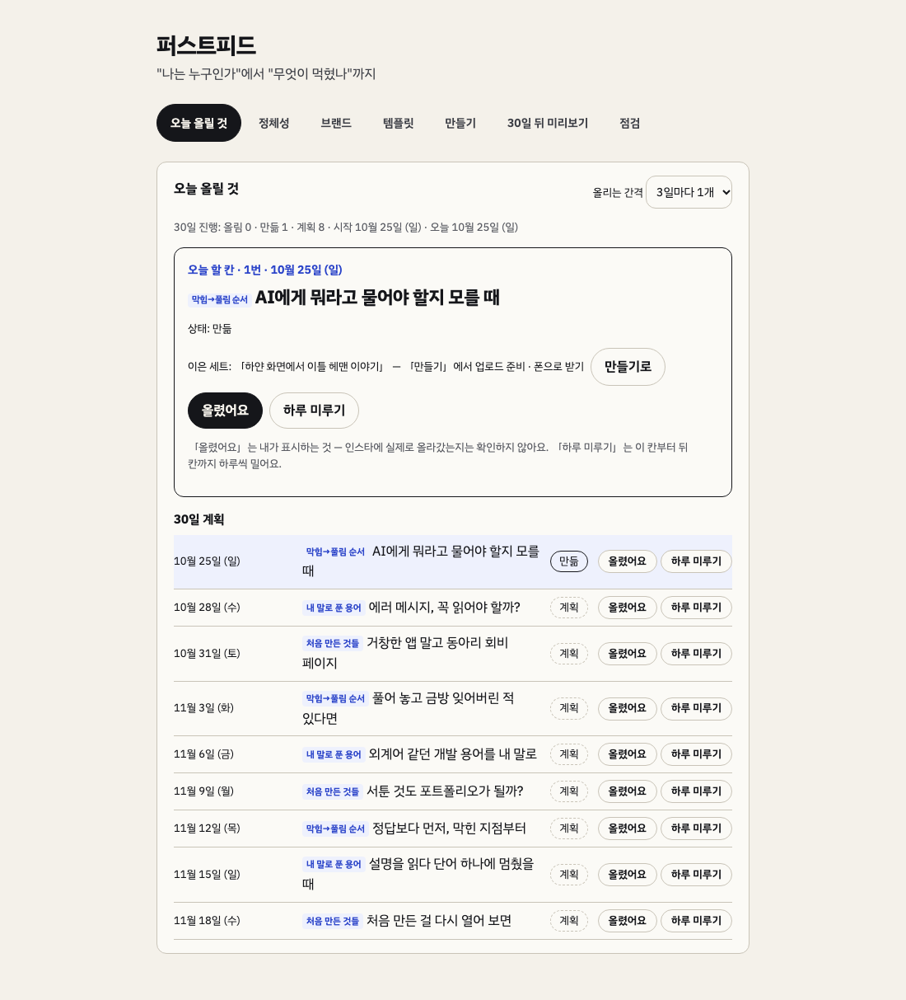
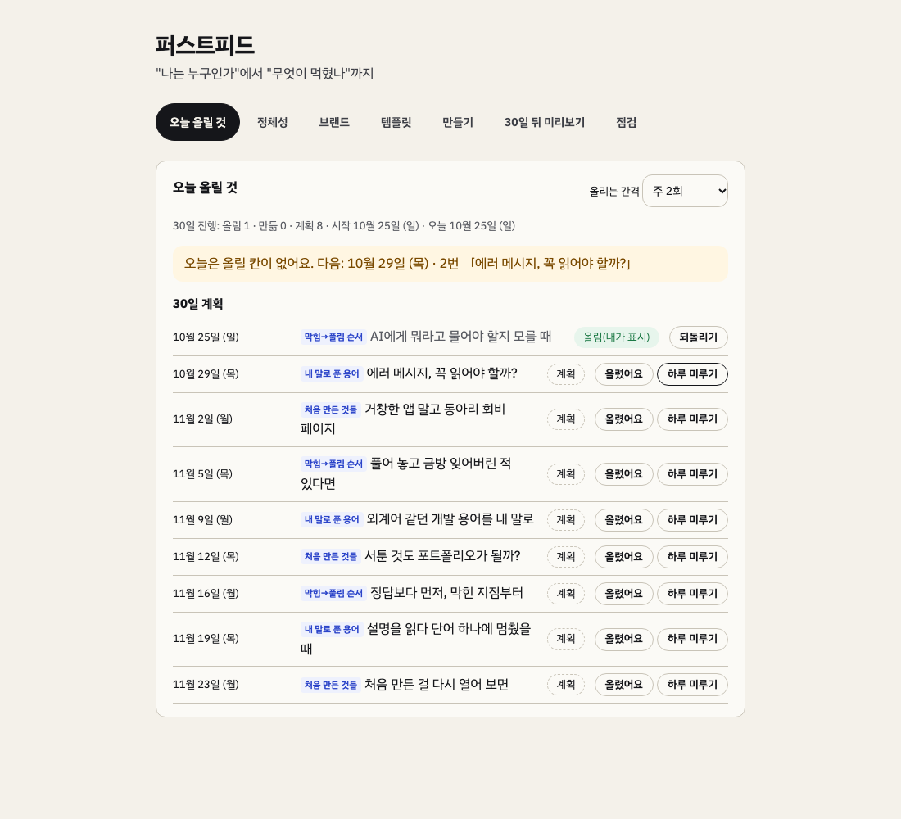
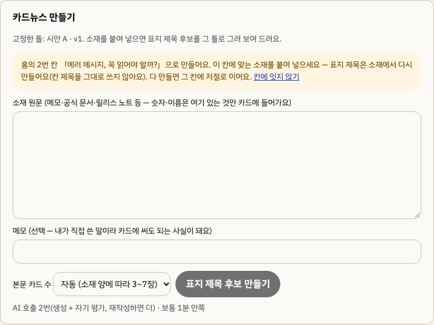
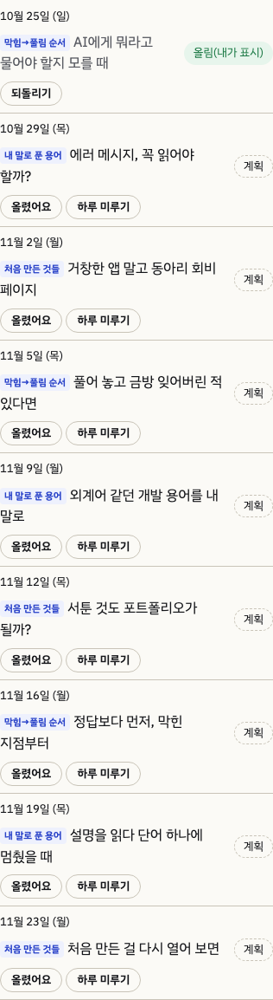

# 2026-10-24-04 · 「오늘 올릴 것」 홈 (FR-HM-1~3)

| 항목 | 내용 |
|---|---|
| 세션 ID | `6887510c-f5b2-49b7-a2cf-d074e050fe51` (같은 세션) |
| 시간 | 2026-10-25 새벽 KST |
| 도구 · 모델 | Claude Code · Opus 5.5 |
| 목표 | C(시간이 남으면) — 설계서 1장대로, 사용자 결정 기본값(3일마다 1개 · 주 2 · 3회 · 사용자 표시 · 하루 미루기) |
| 커밋 | `cbe1496` 서버 · `008f73f` 화면 · `b538734` 결정 · `337c0b0` PRD · status · `734e65f` 설계서 정정 · 이 devlog |

## 한 일

1. **서버**(`cbe1496`): 마이그레이션 013 `home_slots`(칸 번호 · 이은 세트 · 올린 날 · 미룬 날 수), `server/src/home/`
   - `schedule.ts`(순수 함수): 예정일 = 시작일 + 간격. 기본 3일마다(`home.cadence` every3), 주 2회 = 3 · 4일 번갈아(월 · 목처럼), 주 3회 = 2 · 2 · 3일(월 · 수 · 금처럼). 「하루 미루기」는 그 칸부터 **뒤 칸까지** 하루씩(한 칸만 밀면 다음 칸과 겹쳐서). 오늘 할 칸 = 안 올린 칸 중 예정일이 오늘이거나 지난 가장 앞 칸
   - `store.ts`: 홈 값 · 세트 잇기(한 세트 한 칸) · 「올렸어요」/되돌리기 · 하루 미루기(올린 칸은 못 미룸) · 간격. 세트를 잇거나 올린 칸은 **계획에서 고정** — 계획을 다시 만들어도 같은 번호 칸에 남게
   - 시작일(`home.startDate`)은 계획이 있을 때 홈을 처음 연 날로 한 번만 정한다
   - API `/api/home` — 바꾸는 요청은 홈 값을 다시 돌려주고, 안 되는 일은 400 + 이유와 할 일
2. **화면**(`008f73f`): 새 탭 「오늘 올릴 것」을 **앱 첫 화면**으로. 오늘 할 칸(지난 날짜면 표시) · 상태 **계획 / 만듦 / 올림(내가 표시)** · 「이미 만든 세트 고르기 → 이 칸에 잇기」 · 「올렸어요」 · 「하루 미루기」 · 30일 계획 목록 · 올리는 간격 고르기 · 요일까지 보이는 날짜. 계획이 없으면 무엇을 먼저 할지 안내
   - 「이 칸으로 만들기」 → `#/make?slot=N` → 만들기 탭 맨 위에 「홈의 N번 칸 「제목」으로 만들어요 — 표지 제목은 소재에서 다시 만들어요(칸 제목을 그대로 쓰지 않아요). 다 만들면 그 칸에 저절로 이어요」 + 「칸에 잇지 않기」. 세트가 저장되면 그 칸에 잇고, 못 이으면 홈에서 이으라고 알린다
3. 테스트 12개(예정일 5 · 홈 7) — 단위 337 → 349

## 결정 · 정정

`#결정` CLAUDE.md 「2026-10-24 · 설계서 0장 고름」 아래(`b538734`). PRD FR-HM-1~4 신설 S(**우선순위 사용자 확인 필요**) → 69개, status HM-1 · 3 끝남 · HM-2 진행 · HM-4 안 함(`337c0b0`)

`#트러블슈팅` **설계서가 틀렸다**: 1장에 「그 칸 제목을 표지 API 의 requested(원하는 제목)로 넘김」이라 썼는데, 만들려고 코드를 보니 `requested` 는 **본문 카드 수**였다. 설계를 쓸 때 이름만 보고 확인하지 않았다 → 설계서 정정(`734e65f`, 옛 문장 줄 긋기). 칸 제목을 표지 생성에 넘기려면 표지 프롬프트 새 판과 측정이 필요해 이번엔 하지 않았다(안내로만)

## 화면 확인

`#측정` 임시 데모 데이터(계획 9칸 · 만든 세트 1)로 Playwright:
- 첫 화면 탭 = 「오늘 올릴 것」 · 오늘 할 칸 1번(10월 25일 일)
- 「이미 만든 세트 고르기」 → 「이 칸에 잇기」 → 상태 「만듦」 · 이은 세트 표시
- 「올렸어요」 → 「오늘은 올릴 칸이 없어요. 다음: 10월 28일 (수) · 2번」 · 진행 「올림 1 · 만듦 0 · 계획 8」(이은 칸을 올렸으니 만듦 0)
- 2번 칸 「하루 미루기」 → 10월 29일(목) · 3번 11월 1일 · 4번 11월 4일(뒤 칸까지 하루씩)
- 간격 「주 2회」 → 10월 25 · 29 · 11월 2 · 5(미룬 하루 유지)
- `#/make?slot=1` → 만들기 탭 · 2번 칸 안내 · 「칸에 잇지 않기」를 누르면 주소가 `#/make` 로, 안내 사라짐
- 390px 가로 넘침 0 · 페이지 오류 0. 처음엔 390px 에서 날짜가 좁은 칸에 세 줄로 꺾여 날짜를 따로 줄로 옮김

## 확인 못 한 것 · 알려진 한계

- **실제 AI 로 세트를 만들어 칸에 저절로 이어지는지**(FR-HM-2 — 그래서 진행). 확인하려면 만들기 탭에서 소재로 세트를 한 번 만들면 된다(AI 호출 4번 안팎)
- 프로필이 바뀐 뒤 계획을 다시 만들면 고정 칸도 유지되지 않아(plan.ts) 홈의 이은 · 올린 표시가 다른 제목 칸에 붙을 수 있다
- 미리보기 격자 · 공유 이미지에서 칸 상태 3가지(FR-HM-4)는 안 함 — 격자 순서를 실제 게시 순서와 맞출지 먼저 정해야 한다 **(사용자)**
- 시작일을 사용자가 고르는 화면은 없다(처음 연 날로 고정)

## 다음에 할 것

- [ ] FR-HM-1~4 우선순위 **(사용자)**
- [ ] 격자 순서(실제 게시 순서와 맞출지) → FR-HM-4 **(사용자)**
- [ ] FR-MK-9(순서상 다음)
