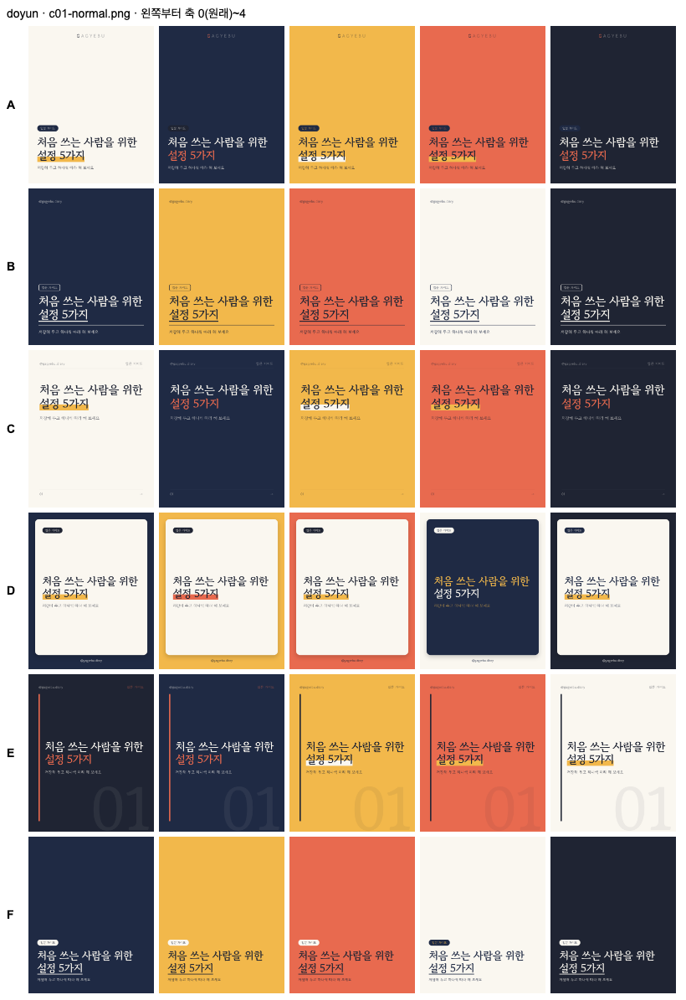
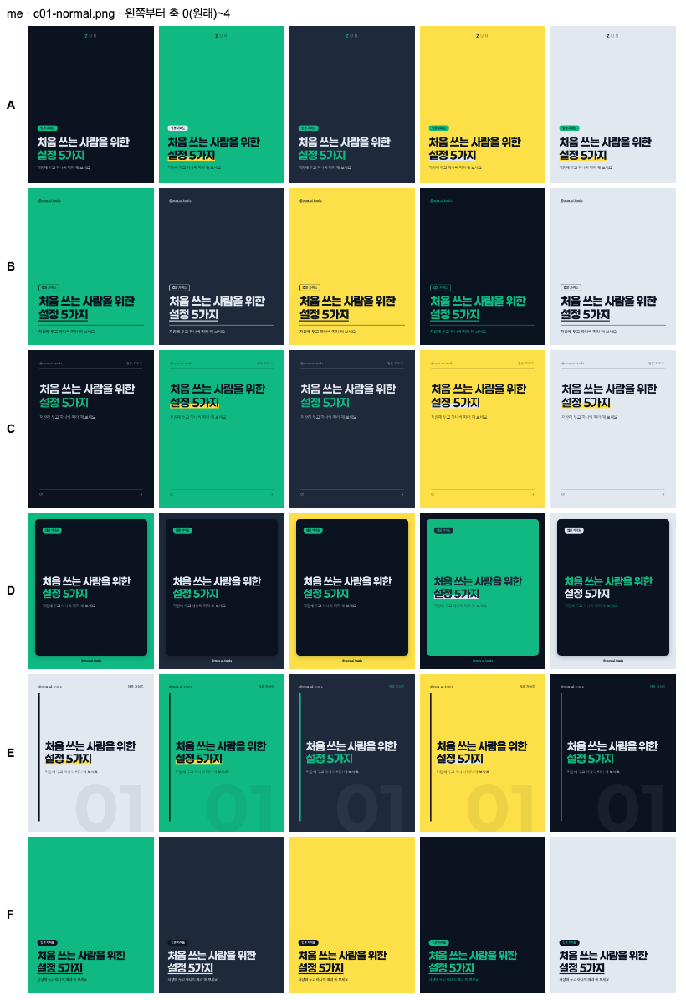
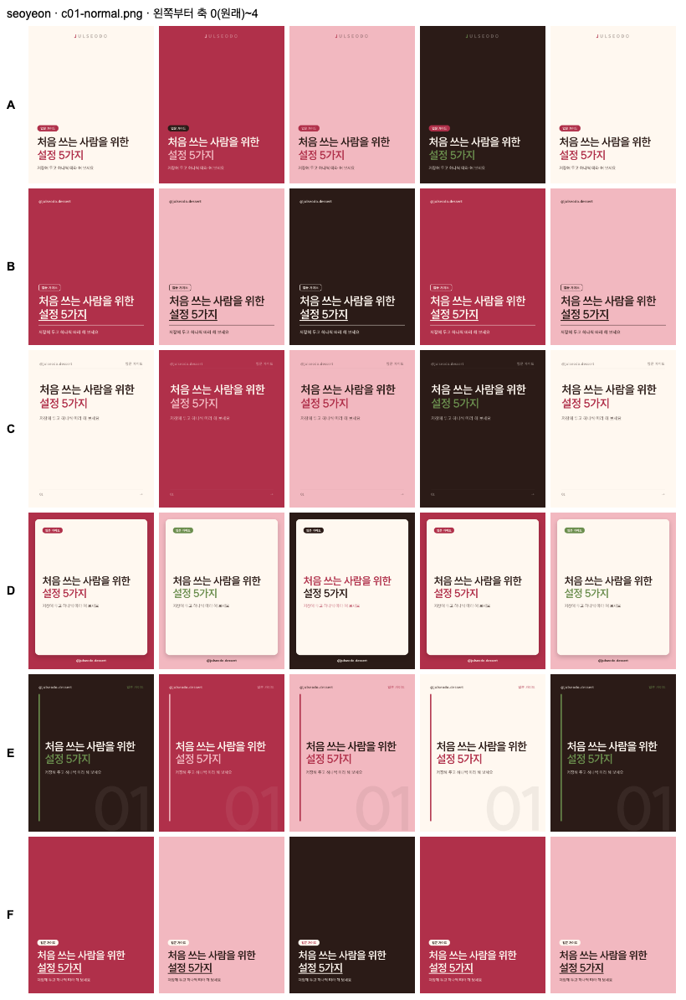
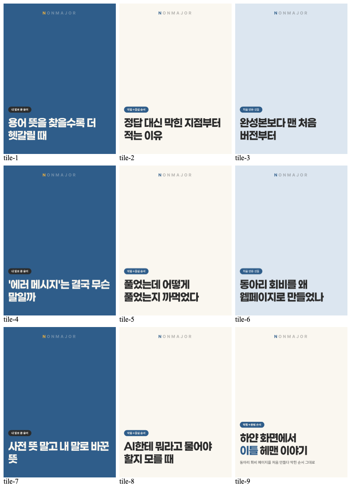
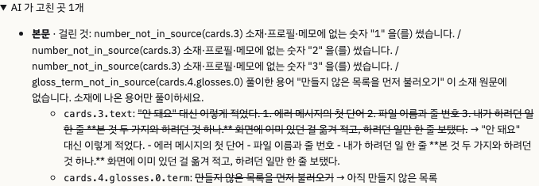
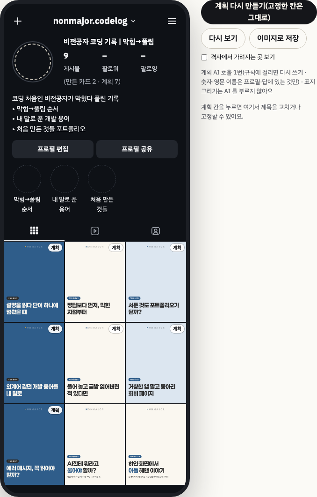

# 2026-10-25-01 · 격자 순서 · 칸 유지 · 칸 상태 · 폰 모양 · 축 색 변형 · 홈 다듬기 · 확인 실행

| 항목 | 내용 |
|---|---|
| 세션 ID | `6887510c-f5b2-49b7-a2cf-d074e050fe51` (같은 세션) |
| 시간 | 2026-10-25 새벽 KST |
| 도구 · 모델 | Claude Code · Opus 5.5 |
| 목표 | 사용자 결정 4개(우선순위 · 격자 순서 · 칸 유지 · FR-HM-4) + 화면 다듬기 A(폰 모양) · B(축 색 변형) · C(홈) + 확인 실행(AI 5회) · 보고서 그림 1 · 2 |
| 커밋 | `f080052` 결정 · `c489b25` PRD · status · `0ff1765` 순서 · 상태 · 유지 · `65c2b20` 미리보기 폰 모양 · `2acead2` 공유 이미지 · `645ae24` 축 색 변형 · `909e491` 홈 · `5dfb8fc` 바이오 5줄 테스트 · `78a13f8` · `aac4c7e` 기록 · `6052218` 보고서 그림 · `08d0d0e` 소개 페이지 · 이 devlog |

## 결정 반영

`#결정` CLAUDE.md 「2026-10-25 · 격자 순서 · 칸 유지 · 칸 상태」
- 우선순위 FR-HM-1~3 **F** · FR-HM-4 **S** → M 21 · F 17 · S 21 · W 10 = 69
- **격자 순서 = 실제 인스타(최근이 왼쪽 위)**: 게시 순서(잇지 않은 만든 세트 만든 순 → 계획 1번 칸부터, 이은 세트는 그 칸 자리) 중 9개를 최근 것부터 → 마지막에 올릴 칸이 왼쪽 위, 1번 칸이 오른쪽 아래. 미리보기 · 공유 이미지 · 소개 페이지 내보내기가 같은 `composeGrid`
- **이은 · 올린 칸은 프로필 판이 바뀌어도 유지**, 「고정」만 한 칸은 같은 프로필 판일 때만. 남길 칸은 계획 규칙 검사에서 뺐다 — 옛 축 ID 라 `unknown_pillar` 로 재작성이 끝없이 나지 않게(테스트: 새 프로필 · 새 축 ID 로 다시 만들어도 올린 칸은 그대로, 고정만 한 칸은 새로)
- **칸 상태 3가지(FR-HM-4)**: 계획 「계획」 · 만듦(배지 없음) · 올림 「올림」(사용자 표시). 그림 없는 칸을 올렸다고 표시해도 소개 페이지에서는 planned(만든 것처럼 보이지 않게)

## A. 미리보기 = 소개 페이지의 폰 프로필

- 다크 폰 틀 안: 위 줄(+ · 아이디 · 메뉴) · 사진 테두리 · 이름 · 게시물 수 · 팔로워 「–」 · 팔로잉 「–」 · (만든 카드 · 계획 · 올림) · 바이오 타이핑 · 프로필 편집/공유 모양 · 하이라이트 · 탭 · 가장자리까지 3열 격자. 인스타 로고 · 인증 배지 · 무지개 테두리 · 고유 아이콘 없음
- **조작은 폰 틀 밖**(넓으면 옆, 좁으면 아래). 칸 안 고치기 · 고정 → 「계획 칸을 누르면 옆에서」(고른 칸 강조선)
- 공유 이미지도 같은 결(다크 · 「게시물 N · 팔로워 – · 팔로잉 –」). `#트러블슈팅` 머리 줄이 늘자 세로 flex 가 바이오를 줄여 담아 「바이오 17px 넘침」으로 PNG 가 막혔다 → 머리 칸 flex:none + 크기 조정. 커밋 메시지에 「5줄까지 들어가게」라 적고 계산만 해서, 테스트를 따로 더해 확인(`5dfb8fc`)

## B. 축 색 변형

- `templates/variant.ts`: 시안의 표지 바탕 역할(A·C background · B·D·F primary · E text)을 팔레트의 다른 역할과 **맞바꾼다**(팔레트 밖 색 없음). 글자 · 바탕 4.5:1, 주색 바탕이면 그 위 글자도 4.5:1(모자라면 글자 역할을 팔레트 안에서 고름 · 안 되면 버림). 0번 축 = 원래. 표지 · 릴스 표지에만
- **renderFrame 한 곳**에서 적용 → 표지 후보 · 본문 단계 표지 · 그림 바탕 표지 · 계획 칸 표지가 같은 길. `#측정` 브라우저 테스트: 같은 축이면 **계획 칸 표지와 실제 카드 표지가 바이트까지 같은 PNG**, 축이 다르면 다름, 끄면 원래 색
- 설정 `render.pillarCoverVariant`(기본 켬) · 템플릿 탭 「표지 바탕색을 축마다 다르게」
- 변형 수(테스트 브랜드 3 · 데모): 시안마다 3~5개 — 축 3개면 축마다 다른 색
- `#측정` 넘침 테스트 세트를 변형으로(`npm run eval:templates -- --photos= --pillars=1,2,3,4`, 1440장): **표지 · 릴스 표지 1008건 판정이 원래(축 0)와 모두 같음**(색은 배치를 바꾸지 않으니 기대대로). 결과 `tests/results/2026-10-25-templates-pillar.md` + `_sheet.png` 90장(장별 PNG 74MB 는 레포에 안 넣음). 시안 × 축 한눈에 보기를 브랜드마다 열어 확인 — 모두 읽힌다. me(어두운 팔레트)는 이웃 축이 비슷한 어두운 색이라 리듬이 약한 곳이 있다
  -   
- `#트러블슈팅` 처음 돌린 측정이 「측정·캡처 20초」 시간 제한으로 멈췄다 — 같은 때 타입 체크를 같이 돌려 CPU 를 잡았다(「겪은 오류」 브라우저 테스트 · CPU 와 같은 모양). 혼자 다시 돌려 끝까지
- 관찰: 데모 격자는 축 3개가 3열을 차례로 돌아 **열마다 한 색(세로 줄무늬)**이 된다  — 그대로 둘지 **사용자 확인 필요**

## C. 홈

- 줄마다 3:4 작은 표지(만든 칸은 세트 표지, 계획 칸은 미리보기와 같은 계획 칸 표지 — AI 없음), 「9칸 중 N칸 올림」 + 칸마다 실제 상태 조각, 오늘 칸 굵은 테두리 · 그 칸 표지 · 목록의 「오늘 ·」. 1100 · 390px 가로 넘침 0

## 확인 실행 (실제 AI 5회)

`#측정` 데모 브랜드 임시 데이터. 먼저 내가 테스트하며 남긴 홈 표시(1번 칸 올림 · 잇기, 간격 주 2회)를 지웠다 — 보고서 그림에 지어낸 「올림」이 찍히지 않게. 소재는 AI 생성(`tests/fixtures/generated/sources/demo-error-message.md`, 오늘 칸 제목에 맞춘 가상 이야기)
- 홈 → 오늘 칸 1번 「AI에게 뭐라고 물어야 할지 모를 때」 → 「이 칸으로 만들기」 → 만들기 탭 안내 → 소재 → 표지 후보
- **대기 단계가 실제로 이렇게 보였다**: 5초 「표지 제목 후보 쓰는 중 (1번째 AI 호출)」 → 34초 「카드에 그려 보고 글이 넘치지 않는지 확인 중」 → 36초 「다른 눈으로 다시 읽는 중 … (2번째)」 → 53초 표지 후보(AI 2번 · 재작성 0 · **뺀 후보 1개**) → 첫 후보 → 54초 「본문 카드 쓰는 중」 → 101초 **「다시 쓰는 중 (2번째 AI 호출) — 걸린 이유: 소재·프로필·메모에 없는 숫자 "1" · "2" · "3"」** → 134초 자기 평가 → 147초 저장
- **FR-HM-2 확인**: 「홈의 1번 칸에 이었어요」, 홈 1번 칸 상태 「만듦」 → status 끝남
- **「AI 가 고친 곳 1개」 — 실제 생성에서 처음 남은 기록**(보고서 그림 1):  세트 전체 [fig1-set](img/2026-10-25-01-fig1-set.png) · 표지 단계 [뺀 후보](img/2026-10-25-01-covers.png)
- 미리보기(새 모양, 모션 끝난 상태 — 보고서 그림 2):  휴대폰 너비 [mobile](img/2026-10-25-01-preview-mobile.png) · 홈 [home](img/2026-10-25-01-home.png) · 공유 이미지 [share](img/2026-10-25-01-share.png)
- 보고서 그림 1 · 2 경로를 새 캡처로(`6052218`)

## 소개 페이지

`08d0d0e` 새 순서 · 축 색 변형으로 다시 내보냄(AI 없음). 소개 페이지 자체(시안)는 그대로 — 4번 칸 배지 가림 문제(2026-10-24)도 그대로 남아 있다

## 확인 못 한 것

- 그림 바탕 표지(시안 F 에 그림 올리기)에서 변형이 어떻게 보이는지(그림이 바탕을 덮어 배지 · 글자색만 바뀜 — 짐작, 안 그려 봄)
- 축 색 변형을 켜기 전에 만든 세트의 표지는 그대로라, 그 세트가 미리보기에서 새 규칙과 다른 색일 수 있다(데모의 「하얀 화면」 세트는 0번 축이라 같음)
- 공유 이미지를 실제 인스타 스토리에 올렸을 때 잘림

## 다음에 할 것

- [ ] 세로 줄무늬 리듬을 그대로 둘지(예: 축 순서와 열 수가 겹치지 않게 돌리기) **(사용자)**
- [ ] 소개 페이지 4번 칸 배지 · 보고서 그림을 사용자 계정 데이터로 다시 찍을지 **(사용자)**
- [ ] FR-MK-9(순서상 다음)
