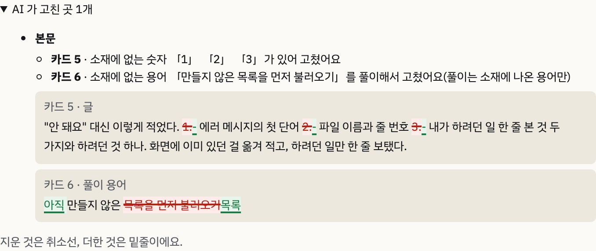
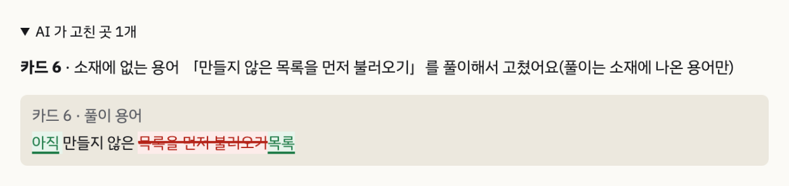
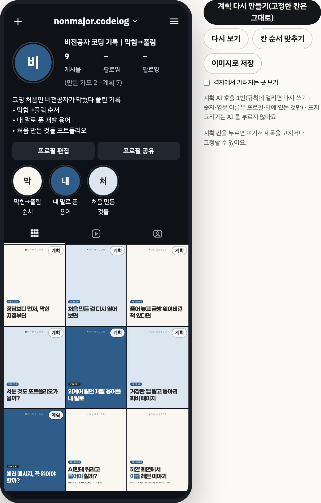
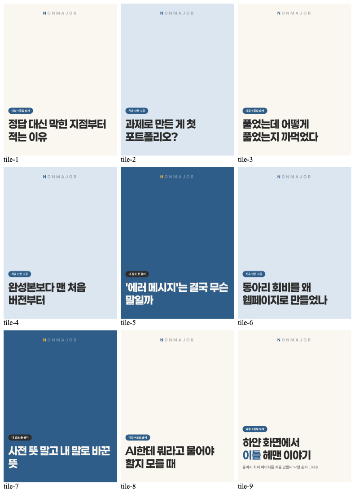

# 2026-10-25-02 · 목록 번호 오탐 · 「AI 가 고친 곳」 사람 말로 · 줄무늬 없애기 · 글자 원 · 그림 1 · 2 다시

| 항목 | 내용 |
|---|---|
| 세션 ID | `6887510c-f5b2-49b7-a2cf-d074e050fe51` (같은 세션) |
| 시간 | 2026-10-25 새벽 · 저녁 KST |
| 도구 · 모델 | Claude Code · Opus 5.5 |
| 목표 | 사용자 지시 1~4 — 근거 규칙 오탐 · 고친 곳 화면 · 미리보기 다듬기 · 그림 다시. AI 호출 없음 |
| 커밋 | `2af5202` 목록 번호 · `28a272f` 결정 · 겪은 오류 · `7ce6e97` 고친 곳 사람 말로 · `983ecaf` 칸 순서 · `f93327d` 글자 원 · `adbf581` 하이라이트 색 · `56afc2a` 소개 페이지 배지 · `3957636` 글자 원 가운데 · `e646017` 소개 페이지 · `2fbf199` 보고서 · 이 devlog |

## 1. 근거 규칙 오탐 — 목록 번호 (`2af5202`)

`#트러블슈팅` 확인 실행(devlog 2026-10-25-01)의 「AI 가 고친 곳」 number_not_in_source 1 · 2 · 3 은 본문 카드의 목록 번호였다(사용자 지적). 임시 데이터의 ai_runs 에 남은 걸린 시도의 글을 열어 확인: `\n\n1. 에러 메시지의 첫 단어\n2. 파일 이름과 줄 번호\n3. 내가 하려던 일 한 줄` — 줄 첫머리 목록
- 원인의 모양: **구조에서 생긴 숫자를 사실 숫자로 셌다**(「겪은 오류」에 올림). 카드 장수 · 개수 표현은 구조 숫자로 넘겼지만 글 안의 목록 표시는 빠져 있었다
- 해결: `stripListMarkers` — 줄 첫머리 「1.」 「2)」 가 1부터 차례로 이어지면 그 번호 자리만 비우고 대조. 새 「1.」 은 새 목록. 차례가 깨진 번호 · 1로 시작하지 않는 번호 · 문장 안의 숫자는 그대로 검사. findUngrounded 한 곳이라 카드 · 캡션 · 바이오 · 시리즈 계획 모두
- 테스트: 실제로 걸린 글 통과 · 「3. 팔로워 120명」의 120 걸림 · 「1. 3.」의 3 걸림 · 5로 시작 걸림 · 문장 안 「1. 2.」 걸림 · 목록 두 개 통과
- `#측정` **지난 측정 기록(tests/results)에서 같은 모양 오탐: 0번.** `number_not_in_source` 가 남은 기록 5건(10-15 cards · cards-body-v1 · rerun-seoyeon · 10-20 cards-gen-v3 표지 후보, 10-15 cards 메모 1)은 모두 「평일 0분」의 **0 — 사실 숫자**(원문에 「0분」이 없음)라 이번 모양이 아니다. 본문 재작성 이유는 「N번째 재작성 · …」로 남는데 숫자 규칙으로 걸린 줄이 없었다. 측정은 다시 돌리지 않았다
  - 한계: tests/results 는 표지 후보에서 뺀 것과 자기 평가 지적 위주로 남겨, 본문 재작성의 규칙 위반을 모두 남기지는 않았다 — 「0번」은 남은 기록 안에서의 수

## 2. 「AI 가 고친 곳」 사람 말로 (`7ce6e97`)

- `app/src/cards/rewriteText.ts` 한 곳: 규칙 코드마다 한국어 문장 표(표에 없는 코드는 일반 문장), 걸린 값만 「」로, 같은 카드 · 같은 규칙은 한 줄, 말투 경고는 뺌. 카드 번호는 세트 화면의 「1. 표지 · 2. 본문 …」과 같게(본문 cards.N → 카드 N+2) — 사용자 예시는 「카드 4」였지만 화면에 보이는 번호와 맞추려고 이렇게 했다 **(사용자 확인 필요)**
- 전후는 낱말 단위 비교로 바뀐 곳만 — 지운 것 취소선(빨강), 더한 것 밑줄(초록). 마크다운 기호(**)는 지움
- 실제 화면(확인 실행 세트): 「카드 5 · 소재에 없는 숫자 「1」 「2」 「3」가 있어 고쳤어요」 / 「카드 6 · 소재에 없는 용어 「만들지 않은 목록을 먼저 불러오기」를 풀이해서 고쳤어요(풀이는 소재에 나온 용어만)」 — 자른 것 없는 화면: 
  - 카드 5 줄은 이제 오탐으로 아는 것이지만 **그때 실제로 남은 기록이라 지우지 않았다**(이력을 고치지 않는다)

## 3. 미리보기 다듬기

- **줄무늬** (`983ecaf`): `preview/arrange.ts` — 게시 순서에서 i 와 i+3 이 같은 열 위아래(앞에 만든 세트가 몇 개여도 같은 관계). 비용 = 같은 열 이어짐 3 + 옆 칸 같은 축 1, 가장 작은 것 · 같으면 원래 순서에 가장 가까운 것. 고정 · 이은 · 올린 칸은 그 자리. 계획을 만들 때 자동, 이미 있는 계획은 「칸 순서 맞추기」(AI 없음). 테스트: 축 3개 차례 → 같은 열 이어짐 6 → 0, 축 2 · 4 · 5개도 0
  - 한계: 맞추기는 계획 칸만 본다 — 잇지 않은 만든 세트(격자 맨 뒤)와 같은 축이 옆에 올 수 있다(데모 마지막 줄의 크림색 두 칸)
- **글자 원** (`f93327d` · `adbf581` · `3957636`): `preview/swatches.ts` — 사진이 없으면 주색 원 + 이름 첫 글자, 하이라이트는 그 축 표지 바탕색 원 + 첫 글자(이름이 같은 축의 색 — 처음엔 하이라이트 순서로 붙여 데모에서만 우연히 맞았다). 공유 이미지에도 하이라이트 줄 + 격자 양옆 여백 56px — 하이라이트 3개 + 바이오 5줄이 들어가는지 브라우저 테스트로. 캡처에서 프로필 글자가 원 왼쪽 위로 쏠린 것을 보고 고침
- **소개 페이지 배지** (`56afc2a`): 「계획」 배지를 오른쪽 위로(시안의 한 줄)

## 4. 그림 · 소개 페이지

- 그림 1(진짜로 잡은 사례만 — 요약 줄 · 카드 6 이유 · 카드 6 전후를 잘라 이어 붙임, 목록 번호 줄은 뺌): 
- 그림 2(칸 순서 맞춘 뒤 · 글자 원):  휴대폰 너비 [fig2-mobile](img/2026-10-25-02-fig2-mobile.png) · 공유 이미지 [share](img/2026-10-25-02-share.png)
- 소개 페이지: 데모 계획을 arrangePlan 으로 맞춘 뒤 다시 내보냄(`e646017`)  — 칸 순서가 바뀌어 9번째 계획 칸(「과제로 만든 게 첫 포트폴리오?」)이 격자에 들어왔다
- 보고서 그림 1 · 2 경로 갱신(`2fbf199`)

## 확인 못 한 것

- 목록 번호 규칙을 넣은 뒤 실제 AI 로 다시 만든 세트(재측정은 하지 않음 — 지시대로)
- 「①」 같은 동그라미 숫자 · 「가.」 같은 한글 목록은 원래 숫자로 세지 않아 이번 규칙과 상관없음(테스트 없음)

## 다음에 할 것

- [ ] 카드 번호 매기기(카드 N+2 = 세트 화면 번호) 괜찮은지 · 그림 1 캡션에 「목록 번호 오탐 줄은 뺌」을 적을지 **(사용자)**
- [ ] FR-MK-9
