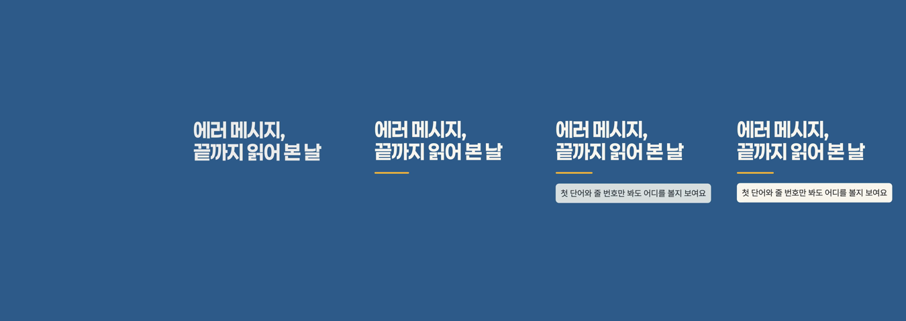

# 2026-10-30-01 · 릴스 만들기 계획 · 작은 실험(모션 → mp4 성공, TTS 는 키 대기)

| 항목 | 내용 |
|---|---|
| 세션 ID | `6887510c-f5b2-49b7-a2cf-d074e050fe51` (같은 세션) |
| 시간 | 2026-10-30 오전 KST |
| 도구 · 모델 | Claude Code · Opus 5.5 |
| 목표 | 릴스(대본 → Fish Audio 무료 TTS → 브랜드 모션 → mp4) 계획 + 「보여 주는 방식」 갈림길(같은 날 추가 지시) + 작은 실험 a · b · c. **구현은 사용자 승인 뒤**, 중간 보고서 초안은 동결 |
| 커밋 | `8705623` 실험 스크립트 · 결과 · `531d104` 계획서 · 이 devlog |

## 한 일

- `#결정` 아님 — 계획서 `docs/service/릴스-계획.md`(정할 것은 0장). PRD 는 승인 뒤
- 공식 자료 확인(2026-10-30): Fish Audio 블로그(무료 판 — 기간이 글 안에서 엇갈림, 날짜 붙은 마지막 연장은 8-31) · 문서 TTS 참조(요청 필드 · 모델 헤더 허용 값, **모르는 모델 값은 유료 s2.1-pro 로 떨어짐**, 응답에 시간 정보 없음 · 응답 형식은 문서에 없음) · 빠른 시작(기본 목소리는 이름 없음, 키 만드는 곳). 계획서 1장에 출처와 함께
- 갈림길: 「보여 주는 방식」은 자유 글(설문 S6 선택 + 덧붙일 말)이라 세 갈래로 바로 안 나뉜다 — 캐릭터는 기존 카드 그림 규칙과 같은 「캐릭터|마스코트」 판정, 「안 한다」 미노출, 「괜찮다」 노출, **「일부만(손·뒷모습)」은 지시에 없는 경우라 사용자 결정**(테스트 세트 minji · demo 가 이 답)
- **실험 a** (Fish 무료 호출): **못 돌림 — 키가 없다**(`.env` 없음). 스크립트만 준비(키 값은 찍지 않음)
- **실험 b** (ffmpeg): `/opt/homebrew/bin/ffmpeg` 8.1.2 · libx264 · aac 있음, GPL 빌드 — 앱은 넣지 않고 사용자 것을 부른다
- **실험 c** (3초 모션 → mp4): 성공 — `tests/results/2026-10-30-reel-motion.md`. 90프레임 8.2초 + 인코딩 2.3초, h264 1080×1920 30fps 3.000초 70KB, mp4 에서 프레임을 다시 뽑아 열어 확인 

## 오류 → 원인 → 해결

`#트러블슈팅`
- **레포 밖 임시 폴더(scratchpad)의 데모 데이터가 지워져 있었다** — 실험 c 를 데모 데이터 폴더로 돌리자 「고정한 템플릿이 없다」, 폴더 안 DB 파일들이 없어지고(디렉터리만 남음) 내 실행이 빈 DB 를 새로 만들었다. 지난 세션들의 데모 브랜드(AI 생성 페르소나로 만든 프로필 · 키트 · 계획 · 세트)를 이제 다시 꺼낼 수 없다
  - 해결: 실험에 필요한 키트 값만 이 세션의 이전 출력에서 `tests/fixtures/generated/brands/demo.json` 으로 옮겨 썼다(출처 note)
  - 영향: 소개 페이지(`site/`)는 이미 내보낸 파일이라 그대로 동작한다. **다시 내보내려면 데모 브랜드를 앱으로 다시 만들어야 한다**(AI 호출 10회 안팎 — devlog 2026-10-22-03)
  - 다시 안 겪으려면: 다시 써야 할 데모 데이터는 레포 밖 임시 폴더에만 두지 않는다 — 만드는 순서(스크립트)를 레포에 남기거나 필요한 값은 고정 입력(fixture)으로
- 단위 테스트 수가 376 → 377: 축 색 변형 테스트가 브랜드 고정 입력마다 돌아 `demo.json` 하나가 늘었다(통과)

## 다음에 할 것

- [ ] 키 넣기(계획서 9장) → 실험 a 한 번 **(사용자 → 나)**
- [ ] 계획서 0장 결정 · PRD 변경안 승인 **(사용자)**
