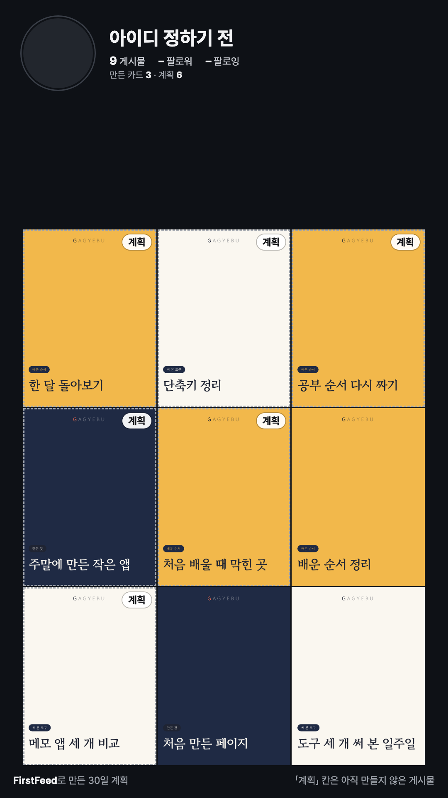
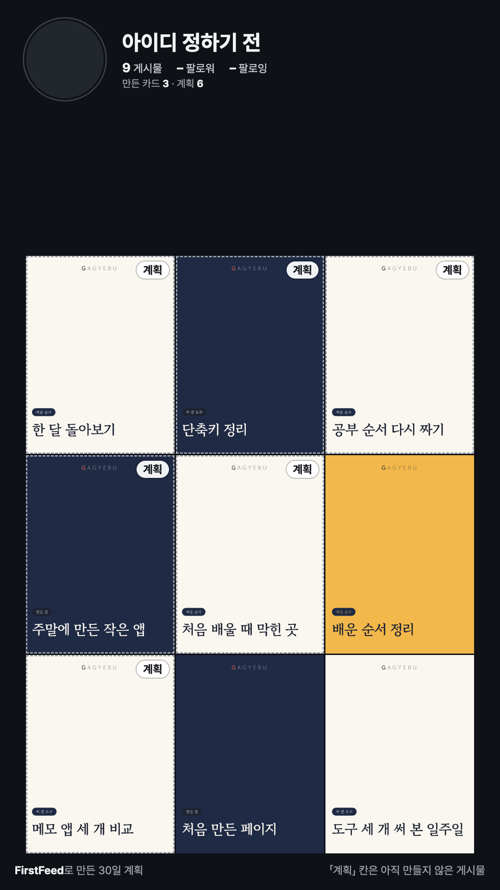
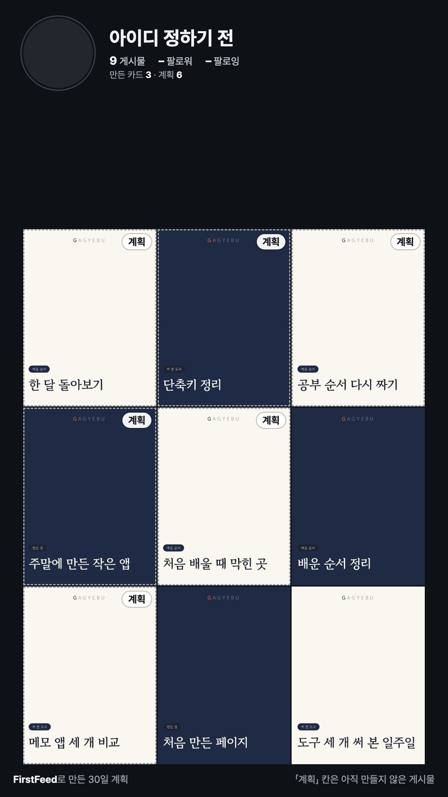
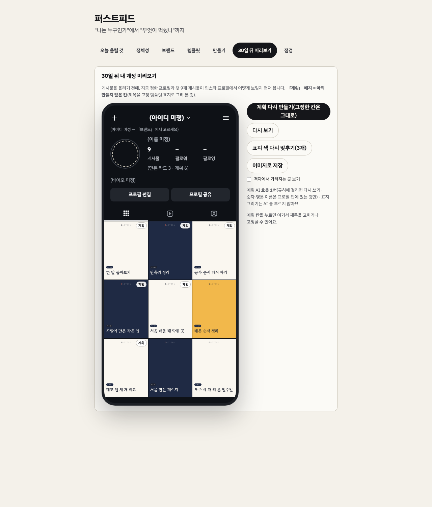
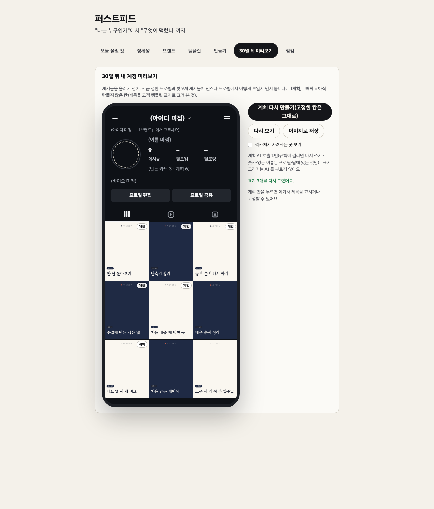
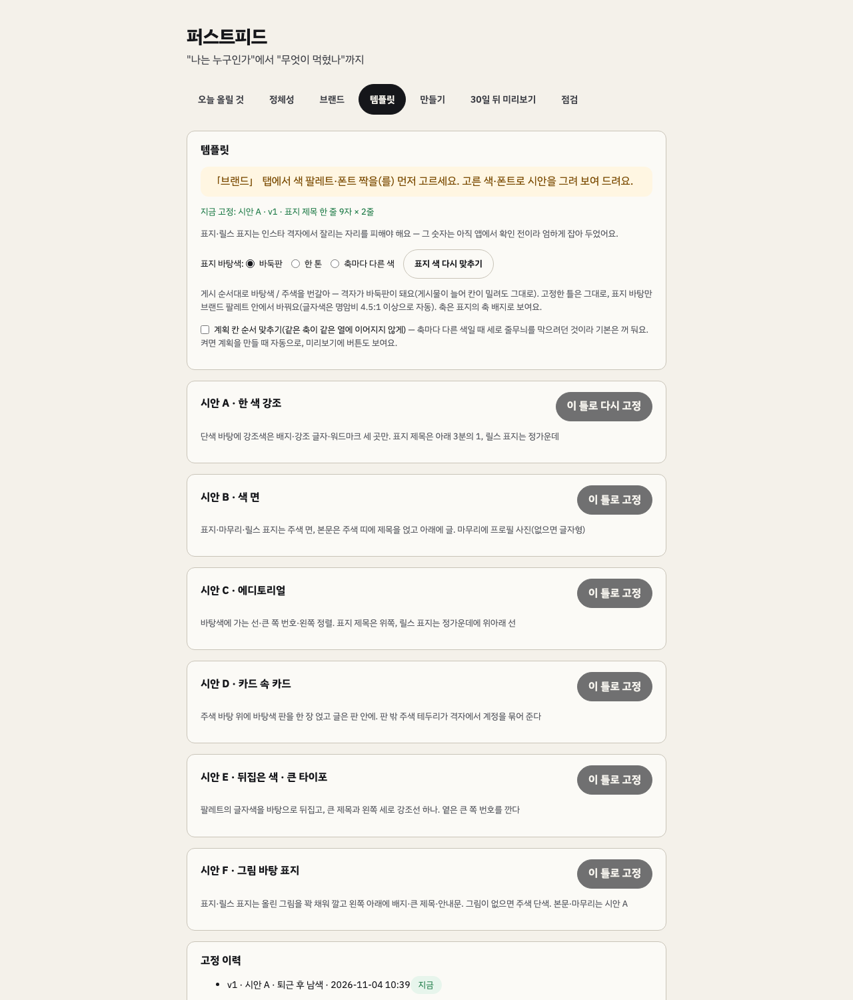

# 2026-11-04-01 · 표지 색 위치 바둑판

| 항목 | 내용 |
|---|---|
| 세션 ID | `3cb2f1e7-4d15-4e31-93cb-c3cdf9c10d90` |
| 도구 · 모델 | Claude Code 2.1.299 · Claude Opus 5.5 |
| 목표 | 미리보기 격자 색이 불규칙해 보이는 것(축 색 변형 + 칸 순서 재배치 + 변형 전에 만든 카드)을 위치 바둑판 규칙으로 바꾼다 |
| 관련 요구사항 | FR-TP-1 · FR-BR-6 · FR-BR-7 · FR-HM-4 |
| 커밋 | 아직 안 함(사용자 확인 뒤 기능 · 기록 두 커밋으로) |

## 한 일
- **표지 바탕색 규칙** `render.coverColorRule` = `checker`(기본) · `single` · `pillar` — `templates/variant.ts` 의 `ruleCoverLook` 하나를 renderFrame 이 지난다(표지 · 릴스 표지만, 본문 · 마무리는 그대로). checker 는 게시 순번 짝수 = 바탕색, 홀수 = 주색. 팔레트 역할만 맞바꾸고, 맞바꾼 짝이 명암비 4.5:1 을 못 지키면 원래 모양
- **게시 순번** `preview/post-order.ts` — 격자 구성(compose-grid.ts)과 표지 그리기(계획 칸 · 표지 후보 · 본문 단계 표지 · 그림 바탕 표지 · 다시 맞추기)가 같은 함수를 쓴다. 격자 칸마다 `seq` 를 붙였다
- **표지 색 다시 맞추기** `cards/recolor.ts` — 표지에 쓴 바탕색을 카드 렌더링 기록 `tone` 에 남기고, 지금 규칙의 색과 다르거나 기록이 없는(규칙 전에 만든) 표지만 다시 그린다. AI 없음 · 표지만 · 넘치면 그 세트는 그대로 두고 이유. 그림 바탕 표지 올리기도 같은 길로 바꿨다. 버튼은 미리보기(다시 맞출 표지가 있을 때만 「표지 색 다시 맞추기(N개)」)와 템플릿 탭
- **칸 순서 맞추기는 기본 끔** `preview.arrangeByPillar` — 계획을 만들 때의 자동 재배치와 미리보기 버튼 모두 설정을 켰을 때만. 템플릿 탭에서 켠다
- 공유 이미지 · 소개 페이지 내보내기: 같은 composeGrid · planCover · 만든 표지 PNG 라 규칙이 그대로 적용된다. 내보내기는 다시 맞출 표지가 남아 있으면 쓰지 않고 멈추게 했다(격자 일부만 옛 색이 되지 않게)
- 하이라이트 원의 축 색은 `pillar` 규칙일 때만(바둑판 · 한 톤이면 팔레트 색 차례)
- 테스트: `npm run typecheck` · `npm run lint` 통과, `npm test` 단위 389 · 브라우저 73 통과. 새 테스트 — 바둑판 증명(post-order.test.ts), 시안 6개 × 테스트 브랜드의 명암비 · 팔레트 안 색(variant.test.ts), 계획 칸 표지 = 같은 순번의 실제 카드 표지 같은 PNG · 앞에 세트가 생기면 계획 칸도 다시 그림 · 다시 맞추기 후 같은 자리 계획 칸과 같은 PNG · 칸에 이으면 다시 맞출 표지로 잡힘(variant.browser.test.ts)
- **캡처**(AI 생성 브랜드 doyun · 시안 A, 계획 제목 9개는 캡처용으로 직접 쓴 것 — AI 생성 아님, 만든 세트 3개 중 1개는 계획 2번 칸에 이음). 운영자 로컬 데이터(본인 브랜드)는 공개 레포 그림에 쓰지 않으려고 쓰지 않았다
  - 이전(축 색 변형 + 칸 순서 맞추기): 노랑 · 흰색 · 남색이 섞여 규칙이 안 보인다 — 
  - 바둑판으로 바꾼 직후: 계획 칸은 바로 바둑판, 변형 때 만든 카드 1장(배운 순서 정리)만 노랑 — 
  - 「표지 색 다시 맞추기」 뒤: 9칸 바둑판 — 
  - 실제 앱 미리보기 화면(개발 서버를 캡처용 데이터 폴더로 띄워 Playwright 로 찍음): 버튼 「표지 색 다시 맞추기(3개)」 → 「표지 3개를 다시 그렸어요.」 뒤 바둑판, 「칸 순서 맞추기」 버튼은 안 보임 —  
  - 템플릿 탭의 규칙 고르기 · 칸 순서 맞추기 체크(기본 꺼짐) — 
  - 다시 맞출 표지 수가 3개로 나온 것은 캡처 데이터의 만든 카드에 색 기록이 없어서다(규칙 전에 만든 카드와 같은 상태). 그중 2장은 이미 같은 색이었지만 기록이 없어 다시 그렸다 — 처음 한 번만 생기는 일
- 확인 못 한 것: **소개 페이지를 실제로 다시 내보내지는 못했다** — 데모 데이터가 레포 밖에서 지워진 상태(devlog 2026-10-30-01)라 `site/data` 는 그대로다. 실제 AI 로 새 세트를 만들어 표지 후보 · 본문 단계에서 순번 색이 붙는 것도 AI 호출 없이 테스트(같은 함수 · 같은 인자)로만 확인했다

## 결정
- `#결정` **3열 격자에서 순번 홀짝 = 바둑판 — 그대로 된다(대안 필요 없음)**. 격자는 최근이 왼쪽 위라 칸 위치 i = (보이는 마지막 순번 − 순번), i = 3·행 + 열 이고 3 이 홀수라 i 홀짝 = (행+열) 홀짝. 그래서 순번 홀짝으로 색을 정하면 이웃 칸끼리 늘 색이 다르고, 게시물이 하나 늘어도 이미 있던 게시물의 색은 그대로다. 테스트: 만든 세트 0~12개 × 계획 0~9칸 × 이은 세트 유무, 1~15개에서 하나씩 늘릴 때 모두 바둑판. 열 수가 짝수(4열)면 같은 규칙이 세로 줄무늬가 되는 것도 테스트에 넣어 「왜 3열이라 되는가」를 남겼다
  - 대가: 지시의 「칸 (행+열)이 짝수면 바탕색」을 **고정할 수는 없다**. 색을 게시물에 붙이면 왼쪽 위 칸의 색은 게시물 수의 홀짝을 따라 번갈아 바뀐다. 반대로 칸 위치에 색을 고정하면 게시물이 하나 늘 때마다 모든 표지를 다시 그려야 하고, 이미 인스타에 올린 표지는 바꿀 수 없다 → 게시물에 붙이는 쪽(지시의 두 번째 문장)을 골랐다. 첫 게시물(순번 0) = 바탕색
  - CLAUDE.md 「이미 내린 결정」에 올림: 예
- `#결정` **만든 카드의 순번이 바뀌는 경우는 자동으로 다시 그리지 않고 표시만** — 순번은 「잇지 않은 세트 → 계획 칸」 순서라, 새 세트가 칸에 이어지거나 잇지 않은 세트가 하나 늘면 그 뒤 게시물의 홀짝이 바뀐다. 계획 칸은 다음에 볼 때 저절로 다시 그려지고(표지 바탕색이 캐시 열쇠), 만든 카드는 「표지 색 다시 맞추기(N개)」로 알린다. 버린 대안: 칸에 이을 때 자동으로 다시 그리기 — 지시는 버튼이었고, 세트 하나를 이으면 뒤 세트들 표지가 함께 바뀌는 것을 사용자가 모르게 하고 싶지 않았다
  - CLAUDE.md 「이미 내린 결정」에 올림: 예
- `#결정` **비교는 그리지 않고 색으로** — 표지에 쓴 바탕색(`tone`)을 렌더링 기록에 남겨 지금 규칙으로 계산한 색과 비교한다. 다시 맞출 표지 수를 미리보기를 열 때마다 PNG 를 그리지 않고 셀 수 있다. 같은 색이면 규칙이 달라도(예: 한 톤과 바둑판 짝수) 다시 그리지 않는다
  - CLAUDE.md 「이미 내린 결정」에 올림: 예(만든 카드도 같은 규칙 줄 안에)

## 오류 → 원인 → 해결
- `#트러블슈팅` **테스트 기대값을 「30일 뒤 모습」이 아니라 「최근 9개」로 잘못 적음**
  - 증상: `expected [ 8, 7, …, 0 ] to deeply equal [ 9, 8, …, 1 ]`
  - 원인: 격자는 계획이 있으면 게시 순서의 **처음 9개**(30일 뒤 모습)를 보인다 — 만든 세트가 칸 수보다 많을 때만 가장 최근 것. 기대값을 거꾸로 생각했다. 코드가 아니라 테스트가 틀림
  - 해결: 기대값을 고치고 주석에 「마지막 계획 칸은 9칸 밖」을 적음
  - 다시 안 겪으려면: 격자 테스트는 compose-grid.ts 머리 주석의 순서 문장부터 읽고 쓴다
  - CLAUDE.md 「겪은 오류」에 올림: 아니오(한 번의 착각, 모양이 일반적이지 않음)

## 측정
- `#측정` **바둑판이 실제로 두 색이 되는가** — 테스트 브랜드 4개(실제·공개 me 1 · AI 생성 3) × 시안 6개 = 24 조합에서 짝수 · 홀수 표지 바탕색이 다른지 셌다(실제·비공개 브랜드 자료는 없음)
  - 실제·공개(me): 6/6 두 색
  - AI 생성: demo 6/6 · doyun 6/6 · **seoyeon 3/6 — 시안 B · D · F 는 한 톤**. 이 세 시안은 주색이 표지 바탕인데, 바탕색으로 바꾸면 바탕 역할에 주색이 들어가 글자 · 바탕 짝이 4.5:1 을 못 지킨다(팔레트 안에서 대신할 글자색도 없음) → 규칙대로 원래 모양으로 남는다. 팔레트 밖 색을 만들지 않는다는 원칙을 지키면 생기는 한계라 그대로 두고 기록만

## AI 협업 메모
- `#AI협업` 지시의 두 문장(「(행+열) 짝수면 바탕색」 · 「색은 게시 순번 홀짝」)이 같이는 성립하지 않는다는 것을 구현 전에 식으로 확인하고, 지시가 「안 되면 이유와 대안을 devlog 에」라고 미리 열어 둔 길대로 기록했다. 「3열이라 된다」는 말로 끝내지 않고 4열 반례까지 테스트로 남겼다
- 캡처에 운영자 로컬 데이터 대신 AI 생성 브랜드를 쓴 것은 공개 레포 규칙 때문 — 로컬 DB 에 운영자 브랜드가 들어 있는 것을 보고 바꿨다

## 다음에 할 것
- [ ] (사용자) 실제 데이터에서 「표지 색 다시 맞추기」 한 번 눌러 보기 — 지금 로컬 세트 3개는 색 기록이 없어 다시 맞출 표지로 잡힌다
- [ ] (사용자) seoyeon 처럼 시안 B · D · F 에서 바둑판이 한 톤으로 남는 브랜드를 어떻게 보일지 — 지금은 조용히 한 톤. 템플릿 탭에 「이 팔레트는 바둑판이 안 돼요」 안내를 붙일지
- [ ] 데모 데이터를 다시 만들면 소개 페이지 내보내기(다시 맞출 표지가 있으면 멈춘다)
