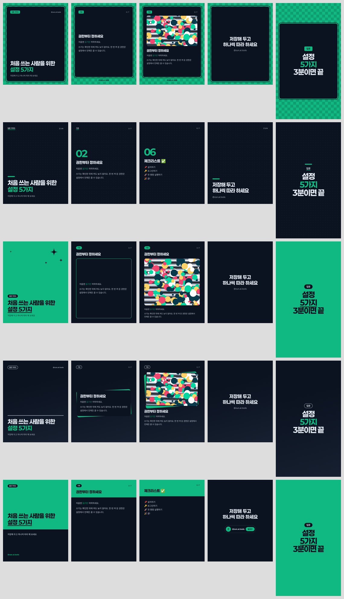
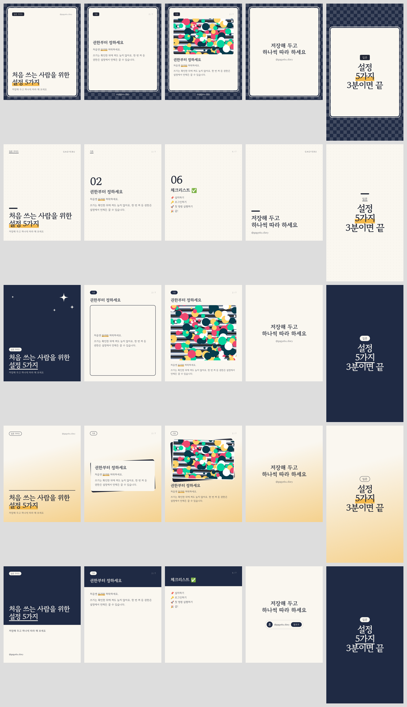

# 2026-11-19-01 · 시안 G~K 다섯 개 · 본문 사진 칸 · 검은고딕

| 항목 | 내용 |
|---|---|
| 세션 ID | `ee2a416f-10fb-5024-8dd8-bb41006c6d43` (같은 세션) |
| 목표 | 사용자가 보낸 Figma 카드뉴스 템플릿 파일 링크 + 「이런 템플릿들도 많이 추가」 |
| 사용자 결정(질문 2개) | 범위 = **5종 이상 + 본문 사진 자리** · 글꼴 = **OFL 두꺼운 제목 글꼴 1종 추가** |
| 바뀐 파일 | `server/src/templates/draft-{g,h,i,j,k}.ts`(새) · `base.ts`(mix · tintFor · photoBox) · `types.ts`(DRAFT_IDS · bodyPhoto) · `index.ts` · `variant.ts` · `render-frame.ts` · `templates/routes.ts`(사진 예시 미리 보기) · `cards/card-photo.ts`(새) · `cards/store.ts` · `cards/routes.ts` · `cards/chat.ts` · `cards/gloss-check.ts` · 마이그레이션 `020_card_photo.sql` · `brand/fonts.ts` · `app/src/cards/MakePage.tsx` · `app/src/templates/TemplatePage.tsx` · `app/src/styles.css` · `scripts/eval-templates.ts` |

## 참고 파일을 어떻게 읽었나

- Figma MCP 는 이 파일에 「편집 권한 없음」으로 막혀, 공개 보기 화면을 브라우저로 열어 확대 · 캡처해서 봤다(캡처는 레포에 넣지 않음 — 세션 임시 폴더만)
- 파일에 적힌 이용 조건: 개인 SNS 용으로 자유롭게 쓸 수 있고, 템플릿 자체의 유료 판매 · 재배포는 안 된다. FirstFeed 는 다른 사람에게 배포하는 앱이고 레포가 공개라 **그림 · 무늬 · 색값을 옮기지 않고 구성만** 가져왔다
- 본 구성: 표지 = 전면 바탕 + 아래쪽 2줄 두꺼운 제목 + 작은 부제(바탕은 체크 무늬 + 안쪽 판 + 작은 배지 / 점 격자 + 흰 판 / 반짝이 / 옅은 그라데이션) · 본문 = ① 바탕 위 가운데 글 상자 ② 위 제목 + 사진 + 아래 설명 ③ 겹친 사진 두 장 + 제목 + 설명 · 마무리 = 아이디 + 팔로우 안내

## 한 일

1. **검은고딕(Black Han Sans) 추가** — npm `@fontsource/black-han-sans` 5.3.0, 패키지 안 LICENSE 가 OFL 1.1 인 것을 열어 확인. 굵기 400 하나. 제목 역할만. 목록 9종
2. **시안 5개** (모두 글은 바탕색 판 · 바탕 · 주색 위에만 — 팔레트 규칙이 보장하는 짝)
   - G 체크 무늬 판: 주색과 「주색·바탕색 16% 섞은 색」의 체크 무늬 위 바탕색 판, 제목은 판 아래쪽
   - H 점 무늬 큰 제목: 글자색 10% 점 격자, 왼쪽 아래 큰 제목 + 강조색 막대, 본문은 큰 쪽 번호
   - I 반짝 표지 + 사진 본문: 주색 면 + 네 갈래 별(SVG), 본문 = 제목 / 사진 / 설명(사진 없으면 테두리 상자 안 설명)
   - J 겹친 액자: 바탕색 → 보조색 그라데이션(끝색은 `tintFor` 로 글자 4.5:1 까지만), 본문은 강조색 판 위에 비스듬히 겹친 사진 액자
   - K 위아래 나눔 + 팔로우: 위 주색 면 / 아래 바탕색, 마무리는 프로필 동그라미 + 아이디 + 「팔로우」 단추(주색)
3. **본문 사진 칸**: `draft.bodyPhoto` 인 시안(G · I · J)의 본문 카드마다 「사진 넣기 · 바꾸기 · 빼기」. 서버는 그 카드만 다시 그리고 `cards.photo` 에 이름을 남긴다. 채팅 고치기 · 풀이 고치기도 사진을 깔고 다시 그린다. 템플릿 탭에는 사진 칸 시안마다 「본문 · 사진 넣은 모양」 미리 보기(팔레트 색 도형 SVG — 글자 · 사람 없음)
4. 측정 스크립트: 사진 칸 시안은 복잡한 테스트 그림(`busy.png`)을 넣은 본문 변형(`G·사진` 등)도 잰다

## 확인

- `npm run eval:templates -- --label=templates-gk --drafts=G,H,I,J,K` → [결과](../../tests/results/2026-11-19-templates-gk.md). 판정 모양이 기존 시안(2026-10-25 측정)과 같아질 때까지 크기를 맞췄다
  - 처음 돌렸을 때 G · H 표지 제목이 기존보다 커서(100 · 112px) 「한도 근처」(c08)가 브랜드 3개 모두 원고 줄이기 → 90 · 100px 로 줄이니 기존처럼 82% 로 줄여서 통과. I · J · K 도 104 → 96px
  - K 마무리가 「handle 과 box:follow 가 겹침」으로 실패 — 아이디 글 칸이 들어 있는 알약 전체를 data-box 로 표시해서 생긴 측정 문제(눈으로는 멀쩡). 「팔로우」 단추만 box 로
  - 사진 본문 I 는 글이 길어지면 사진이 줄어드는데, 끝없이 줄면 「사진 칸이 거의 없는데 통과」가 될 수 있어 최소 높이 360px 을 두었다
- 브랜드 3개(me · doyun · seoyeon) × 시안 5개의 표지 · 본문 · 사진 본문 · 마무리 · 릴스 표지를 한 장으로 모아 열어 봤다(잘림 · 겹침 없음)
  - 줄마다 G · H · I · J · K, 칸은 표지 · 본문 · 사진 본문(사진 칸 없는 H · K 는 이모지 본문) · 마무리 · 릴스 표지 — me(실제 · 공개 키트)  doyun(AI 생성 키트) 
  - 레포에는 측정 표와 조합별 한눈에 보기(`_sheet.png`)만 넣었다 — 낱장 PNG 를 모두 넣으면 55MB
- 검은고딕으로 시안 I 표지를 그려 열어 봄 — 대체 글꼴 경고 없이 검은고딕 모양으로 나옴
- 앱: 운영자 데이터 사본의 세트를 시안 I 로 바꿔 띄우고, 2번 카드에 사진을 넣으니 그 카드만 다시 그려짐(화면 캡처로 확인). 템플릿 탭 두 테마에서 시안 11개 미리 보기 47장(11 × 4 + 사진 예시 3) 다 그려지고 오류 0
- 테스트: unit 447 · browser 93 통과. 새 테스트 — 사진 넣기 → 그 카드 PNG 바뀜 · 다른 카드 사진 없음 → 빼기 → 처음 PNG 와 같음 · 표지에 넣기 400 · 사진 칸 없는 시안(C) 400 / `mix` · `tintFor` · `photoBox`

## 오류 → 원인 → 해결

- `cards/routes.ts` 에 `draftById` 를 쓰고 가져오기를 빠뜨림 → sed 로 넣으려던 줄이 맞지 않아 조용히 안 들어감(「겪은 오류」의 「치환 스크립트가 자리를 못 찾으면 조용히 넘어간다」와 같은 모양) → 타입 체크가 잡았다. 이번 세션의 다른 치환은 모두 `count == 1` 확인을 거쳤다
- 테스트에서 표지 후보를 3개만 준 가짜 응답이 규칙(후보 수)에 걸려 세트가 안 만들어짐 → 기존 테스트와 같은 6개로

## 결정

- CLAUDE.md 「2026-11-19 · 시안 G~K · 본문 사진 칸」 · PRD FR-TP-1(시안 11개)

## 확인 못 한 것

- 실제 AI 로 G~K 고정 뒤 세트를 끝까지 만들어 보지는 않았다(구독 사용량). 칸별 글자 수(예산)는 고정할 때 그 브랜드 폰트로 재므로 시안이 바뀌어도 같은 길로 간다
- 축 색 변형(`--pillars`)은 G~K 로 따로 재지 않았다 — 표지 바탕 역할만 정해 두었다(G · I · K = 주색, H · J = 바탕색)
- 사진 칸 시안에 맞춘 그림 프롬프트(가로 비율 등)는 바꾸지 않았다 — 지금 카드 그림 프롬프트를 그대로 쓴다
