# 유저플로우

> **기준 문서**(결정 2026-10-20, [CLAUDE.md](../../CLAUDE.md)) · 원본: 매니패스트 유저플로우 [`docs/source/manyfast-2026-10-20/`](../source/manyfast-2026-10-20/README.md) (2026-10-20) · 범위·우선순위는 [PRD v0.2](../PRD.md) 4장을 따른다

**읽는 법**
- 실선 노드: 이번 버전에서 만드는 흐름(M·F, 대외활동은 조건부 F). **점선 노드: S(여유가 있으면)** — 발굴 탭(FR-DS-1·2·5·7, 묶음 전체 점선) · 고정댓글·DM 옵션(FR-MK-9) · AI 미연결 프롬프트(FR-AI-8)
- 모양: `(( ))` 시작 · `[ ]` 화면 · `{ }` 사용자 행동·판단 · `[/ /]` 보여 주는 결과

**원본에서 고친 것 (2026-10-20)**
1. S 기능 노드를 점선으로 구분
2. 「자료 올리기 화면 → 브랜드 프로필 초안」 화살표 추가(`n26 --> n19`) — 원본엔 자료 올리기에서 나가는 화살표가 없었다
3. 「풀이·비유 사용자 확인 → 창고 화면」 화살표 추가(`n70 --> n80`) — 원본엔 만들기에서 창고로 가는 길이 고정댓글·DM 옵션(S)을 거치는 것뿐이라, 점선으로 바꾸면 기본 흐름이 S 기능을 지나게 된다

```mermaid
flowchart LR

  subgraph s1 ["진입 및 초기 설정"]
    n1(("앱 최초 실행"))
    n2["로컬 작업공간 초기화"]
    n3{"CLI 연결 상태?"}
    n4["설정 화면"]
    n5[/"Claude CLI 점검 결과"/]
    n6["CLI 연결 오류 안내"]
    n7["홈 화면"]
  end

  subgraph s2 ["정체성 찾기"]
    n10["브랜드 화면"]
    n11{"브랜드 프로필 완성?"}
    n12["설문 화면"]
    n13{"설문 8문항 제출"}
    n14["AI 인터뷰 채팅 화면"]
    n15{"인터뷰 답변 입력"}
    n16{"인터뷰 한도 소진?"}
    n17{"축 3개 이상 근거?"}
    n18["인터뷰 실패 안내"]
    n19["브랜드 프로필 초안"]
    n20[/"프로필 축·근거 인용"/]
    n21{"프로필 수정 요청"}
    n22{"대안 방향 2개 요청"}
    n23["대안 프로필 비교"]
    n24{"되돌리기 실행"}
    n25{"프로필 확정"}
    n26["자료 올리기 화면"]
  end

  subgraph s3 ["브랜딩 키트·템플릿"]
    n30["브랜딩 키트 화면"]
    n31[/"이름·바이오 후보 5개"/]
    n32[/"색 팔레트 3안"/]
    n33[/"폰트 조합 3안"/]
    n34{"키트 항목 선택·저장"}
    n35["프로필 사진·커버 안내"]
    n36["템플릿 고정 화면"]
    n37[/"브랜드 적용 시안 5종"/]
    n38{"시안 고정"}
    n39["렌더링 검증 결과"]
    n40{"렌더링 통과?"}
    n41["렌더링 오류 안내"]
  end

  subgraph s4 ["발굴 탭"]
    n50["발굴 탭 화면"]
    n51{"키워드 등록·켜기/끄기"}
    n52[/"AI 웹 검색 후보 목록"/]
    n53[/"축 적합도·알맹이 표시"/]
    n54{"후보 선호·제외 표시"}
  end

  subgraph s5 ["만들기"]
    n60["만들기 화면"]
    n61{"소재 원문 붙여넣기"}
    n62[/"표지 제목 후보 6개"/]
    n63{"표지 제목 선택"}
    n64["카드뉴스 생성 화면"]
    n65[/"카드·그림프롬프트 결과"/]
    n66[/"캡션 생성 결과"/]
    n67["사실 검증 결과 화면"]
    n68{"검증 통과?"}
    n69["검증 실패 안내"]
    n70{"풀이·비유 사용자 확인"}
    n71{"특정 카드 말로 고치기"}
    n72["고정댓글·DM 옵션"]
    n73["생성 취소·오류 화면"]
  end

  subgraph s6 ["창고·내보내기"]
    n80["창고 화면"]
    n81[/"완성 콘텐츠 목록"/]
    n82{"업로드 준비 내보내기"}
    n83["내보내기 결과 안내"]
    n84{"폴더 중복?"}
    n85["폴더 중복 경고"]
  end

  subgraph s7 ["성과 루프"]
    n90["성과 화면"]
    n91{"인사이트 캡처 추가"}
    n92[/"캡처 읽기 결과·위치"/]
    n93{"수치 확인·저장"}
    n94["성과 분석 화면"]
    n95[/"축·형식·제목 유형 평균"/]
    n96[/"다음 행동 제안 3개"/]
    n97{"표본 3개 이상?"}
    n98["표본 부족 안내"]
    n99{"제안 수락"}
    n100["프로필 갱신 이력"]
  end

  subgraph s8 ["운영·대외활동"]
    n110["운영 화면"]
    n111{"활동 등록"}
    n112["공지 입력 화면"]
    n113{"공지 원문 붙여넣기"}
    n114{"공지 캡처 업로드"}
    n115["할 일 추출 화면"]
    n116[/"마감·제출물·필수표기"/]
    n117["마감순 대시보드"]
  end

  subgraph s9 ["설정"]
    n120["설정 화면(상세)"]
    n121[/"Claude CLI 연결 상태"/]
    n122{"설치 점검 명령 실행"}
    n123["점검 결과 안내"]
    n124["AI 미연결 프롬프트"]
  end

  n1 --> n2
  n2 --> n3
  n3 --> n7
  n3 --> n4
  n4 --> n5
  n5 --> n6
  n6 --> n4
  n7 --> n10
  n7 --> n60
  n7 --> n80
  n7 --> n90
  n7 --> n110
  n7 --> n120
  n7 --> n50
  n10 --> n11
  n11 --> n30
  n11 --> n12
  n12 --> n13
  n13 --> n14
  n14 --> n15
  n15 --> n16
  n16 --> n17
  n16 --> n18
  n17 --> n19
  n17 --> n14
  n18 --> n12
  n19 --> n20
  n20 --> n21
  n20 --> n22
  n20 --> n24
  n20 --> n25
  n21 --> n19
  n22 --> n23
  n23 --> n25
  n24 --> n19
  n25 --> n30
  n10 --> n26
  n30 --> n31
  n30 --> n32
  n30 --> n33
  n31 --> n34
  n32 --> n34
  n33 --> n34
  n34 --> n35
  n35 --> n36
  n36 --> n37
  n37 --> n38
  n38 --> n39
  n39 --> n40
  n40 --> n7
  n40 --> n41
  n41 --> n36
  n50 --> n51
  n51 --> n52
  n52 --> n53
  n53 --> n54
  n54 --> n60
  n60 --> n61
  n61 --> n62
  n62 --> n63
  n63 --> n64
  n64 --> n65
  n64 --> n66
  n65 --> n67
  n66 --> n67
  n67 --> n68
  n68 --> n70
  n68 --> n69
  n69 --> n64
  n70 --> n71
  n71 --> n64
  n70 --> n72
  n72 --> n80
  n64 --> n73
  n80 --> n81
  n81 --> n82
  n82 --> n84
  n84 --> n83
  n84 --> n85
  n85 --> n80
  n90 --> n91
  n91 --> n92
  n92 --> n93
  n93 --> n94
  n94 --> n95
  n95 --> n97
  n97 --> n96
  n97 --> n98
  n96 --> n99
  n99 --> n100
  n100 --> n10
  n110 --> n111
  n111 --> n112
  n112 --> n113
  n112 --> n114
  n113 --> n115
  n114 --> n115
  n115 --> n116
  n116 --> n117
  n117 --> n60
  n120 --> n121
  n121 --> n122
  n122 --> n123
  n120 --> n124
  n4 --> n120

  %% 고친 것 1: 자료 올리기(FR-ID-3)도 프로필 초안으로 이어진다
  n26 --> n19
  %% 고친 것 2: 기본 흐름이 S 기능(고정댓글·DM 옵션)을 거치지 않고 창고로 간다
  n70 --> n80

  %% S(여유가 있으면) 기능은 점선 — 발굴 탭 · 고정댓글·DM 옵션(FR-MK-9) · AI 미연결 프롬프트(FR-AI-8)
  classDef optional stroke-dasharray: 5 5,stroke:#888,color:#666
  class n50,n51,n52,n53,n54,n72,n124 optional
  style s4 stroke-dasharray: 5 5
```

